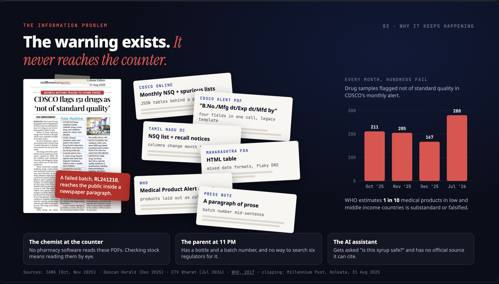

# Nazar

**Har batch par nazar.** An eye on every batch.

Check any Indian medicine batch against CDSCO, state drug regulator and WHO alerts in seconds, with proof anyone can verify on Arkiv.

| | |
|---|---|
| **Web app** | **[nazar-nu.vercel.app](https://nazar-nu.vercel.app)** |
| **REST API** | [`https://nazar-api-production.up.railway.app`](https://nazar-api-production.up.railway.app/health) ([docs](docs/api.md)) |
| **MCP server** | `https://nazar-api-production.up.railway.app/mcp` ([setup guide](https://nazar-nu.vercel.app/ai), [docs](docs/mcp.md)) |
| **Data on Arkiv** | Tiramisu testnet, publisher [`0xd06d…6bD2`](https://tiramisu.explorer.arkiv.network/address/0xd06d85Eb20f126f796E4a341b711B1a757c66bD2) ([directory](https://nazar-nu.vercel.app/arkiv), [docs](docs/arkiv.md)) |

**[For judges: 2-minute tour](docs/for-judges.md)** · [Features](docs/features.md) · [Arkiv](docs/arkiv.md) · [MCP](docs/mcp.md) · [API](docs/api.md) · [How it works](docs/architecture.md) · [Development](docs/development.md)

---

## The problem

India's drug regulators publish failed medicine batches as PDFs, tables and press notes, days apart, in formats no pharmacy software can read.
On 2 October 2025 Tamil Nadu declared batch **SR-13** of COLDRIF syrup adulterated (48.6% w/v diethylene glycol), after child deaths.
On 13 October WHO listed it, with two more contaminated syrups, in Medical Product Alert N°5/2025.
Every state rewrote the same alert by hand, while the pack's printed expiry ran to April 2027.
Nazar turns those scattered notices into one live, verifiable feed that a chemist, a parent at 11 PM or an AI agent can check in under three seconds.

**Everything in Nazar is real.** Every alert comes from a regulator document the pipeline downloaded, hashed and read: 1,404 alerts from 21 notices by CDSCO, Tamil Nadu, Maharashtra and WHO, each a live entity on Arkiv that links back to the original document. A handful of hand-reviewed rows are labelled `curated`, and demo data appears only offline on a first visit, labelled as such ([real vs demo](docs/for-judges.md#real-vs-demo)).

## What Nazar does

Type the batch number from the pack (or scan it). Nazar answers with exactly one of four states:

| Answer | Colour | Meaning |
|---|---|---|
| **Flagged** | red | A named regulator listed this exact batch as not of standard quality, spurious, adulterated or misbranded. You get the notice, its date and the reason in the regulator's words. |
| **Retracted** | amber | An alert on this batch was withdrawn or corrected. The original stays on record. |
| **No alert found** | slate grey | No regulator alert Nazar reads names this batch yet. Always shown with "this is not a safety certificate". |
| **Can't tell** | amber | The batch could not be read, or only a look-alike matched (0/O, 1/I/L, 5/S, 8/B). It offers "Did you mean…?" and never a flag. |

> **Nazar never says a medicine is "safe".** It reports what a named regulator published, on which date, with the document. "No alert found" is never green.

Every result carries the chain of custody: regulator document → SHA-256 → Arkiv notice entity → alert entity, created by Nazar's publisher wallet.

| Check: the eye turns red | Pack Reader, on the phone |
|:---:|:---:|
|  |  |

| Alerts: India pulse | Cabinet: your shelf, watched |
|:---:|:---:|
|  |  |

All screenshots, grouped by feature: [docs/features.md#screenshot-gallery](docs/features.md#screenshot-gallery).

## Try it in 60 seconds

On **[nazar-nu.vercel.app](https://nazar-nu.vercel.app)**:

| Type this | You get | Where it comes from |
|---|---|---|
| `SR-13` (or `B.No. SR-13`) | **Flagged**, severity 5, Child Shield, 2 notices, on-chain proof | COLDRIF, WHO Medical Product Alert N°5/2025 (DEG 48.6% w/v) |
| `TG25-2281A` | **Flagged**, severity 5 | Levcon-M, CDSCO: spurious |
| `R01GL2523`, `LSL25160` | **Flagged**, severity 5 | Respifresh TR and ReLife, the same WHO alert |
| `SST25006` | **Flagged** | Salbutamol tablets, CDSCO and Tamil Nadu |
| `(N)25567` | **Flagged** | Sodium chloride injection, CDSCO (brackets are kept) |
| `5R-13` | **Can't tell**, "Did you mean SR-13?" | A look-alike is never shown as a flag |
| `AB1234` | **No alert found** | Not a safety certificate |

Then open **[/arkiv](https://nazar-nu.vercel.app/arkiv)**, set Child Shield and severity 4+, and watch the Arkiv query change. Or ask your AI assistant "Is batch SR-13 of Coldrif flagged?" once you have [added the MCP server](docs/mcp.md#one-step-setup).

## Features

- **[Check a batch](docs/features.md#check-a-batch)** with four honest answers; a printed "B.No." label is ignored, and a watching eye turns red, amber or slate (never green).
- **[Look-alike guard](docs/features.md#look-alikes):** "Did you mean SR-13?", never a flag.
- **[Strip Scan](docs/features.md#strip-scan):** QR, Data Matrix and GS1 codes plus the printed batch line, read on the device, with a label-mismatch warning.
- **[Pack Reader](docs/features.md#pack-reader):** brand, salts, form, maker, licence, MRP and dates read from a photo, on the device.
- **[Result card](docs/features.md#the-result-card)** with [Child Shield](docs/features.md#child-shield), [severity with reasons](docs/features.md#severity-with-reasons) and the [on-chain proof](docs/features.md#on-chain-proof).
- **[Alerts](docs/features.md#alerts):** search by medicine or maker, "New since your last visit", India pulse, filters in the URL, and [RSS, Atom and JSON feeds](docs/features.md#subscribe-rss-atom-json-feed).
- **[Cabinet](docs/features.md#cabinet):** your shelf, re-checked on every visit, [added from a photo](docs/features.md#add-from-a-photo) with an opt-in AI guess that sends only text; [nav badges](docs/features.md#nav-badges).
- **[Shelf sweep](docs/features.md#shelf-sweep):** up to 500 batches from a paste or CSV, matched on the device, with CSV export and a printable counter sheet.
- **[Sharing](docs/features.md#sharing):** `/b/SR-13` pages with preview cards, WhatsApp and copy link.
- **[About this medicine](docs/features.md#about-this-medicine):** opt-in, AI-generated general information, kept apart from the verdict.
- **[Hindi](docs/features.md#hindi):** EN | हिं across checking, results, alerts, scanner and cabinet; regulator text stays as published.
- **[How it works](docs/features.md#how-it-works-page)**, the **[AI assistant page](docs/features.md#ai-assistant-page)** and the **[Arkiv directory](docs/features.md#arkiv-directory)**.
- **[Offline and fallback](docs/features.md#offline-and-fallback):** API → Arkiv from the browser → the saved copy → demo data.
- **[Accessibility and performance](docs/features.md#accessibility-and-performance):** reduced motion, 44 px targets, a WebGL fallback.

## How it works, in brief

- **Sources:** CDSCO (online NSQ portal and alert PDFs), Tamil Nadu, Maharashtra and WHO, fetched on a schedule by a worker on Railway in Singapore.
- **Deterministic first:** PDF table geometry and per-regulator templates read almost every row; OCR and a grounded LLM only handle the rest, and every LLM value must appear in the source text.
- **Truth on chain:** each notice and each batch alert is a `readonly` Arkiv entity; Nazar's database is a cache that can be rebuilt from Arkiv.
- **Always answers:** API → Arkiv from the browser → the saved copy on the device → demo data (offline first visit only).
- **Private by default:** checks, the cabinet, sweeps and photos stay on the device.
- **Live (18 Oct 2026):** 1,404 alerts and 21 notices on Arkiv, a heartbeat renewed every 5 minutes, 430 backend tests, 39 scanner tests and 750 e2e checks.

Details: [docs/architecture.md](docs/architecture.md).

## Documentation

| Doc | What's in it |
|---|---|
| [For judges: a 2-minute tour](docs/for-judges.md) | track fit, why Arkiv is essential, a click-by-click verification path, real vs demo, limits |
| [Features](docs/features.md) | every feature in depth, with the screenshot gallery |
| [Use the data on Arkiv](docs/arkiv.md) | entity types, copy-paste SDK examples, raw query strings, runnable scripts |
| [Use Nazar from AI agents (MCP)](docs/mcp.md) | setup per client, the six tools, the honesty rules, a worked example, testing |
| [REST API](docs/api.md) | every endpoint, feeds, errors, rate limits, CORS and caching |
| [How it works](docs/architecture.md) | pipeline, extraction tiers, severity, automation, the fallback chain, privacy |
| [Development](docs/development.md) | run it yourself, environment variables, deploy, tests and CI, project structure |
| [Arkiv query reference](arkiv/README.md) and [data contract](arkiv/schema.md) | runnable query scripts; every attribute, lifetime and flag |
| [Backend internals](Nazar-backend/README.md) | sources, extraction, resolve, publishing, CLI |

An index of the docs is in [docs/README.md](docs/README.md); [llms.txt](llms.txt) is the same for language models.

## Quick start: Arkiv

Every alert is a public entity: filter by `project = "nazar-in-batch-alerts"`, the type `t`, and `.createdBy(0xd06d85Eb20f126f796E4a341b711B1a757c66bD2)`.
`npm install @arkiv-network/sdk@0.8.0 viem`, then copy the examples in [docs/arkiv.md](docs/arkiv.md#copy-paste-sdk-examples).
Runnable scripts: `cd arkiv/queries && npm install && npx tsx check-batch.ts SR-13` ([arkiv/README.md](arkiv/README.md)).

## Quick start: MCP

Endpoint: `https://nazar-api-production.up.railway.app/mcp` (stateless Streamable HTTP, read-only, no key).
Claude Code: `claude mcp add --transport http nazar https://nazar-api-production.up.railway.app/mcp`.
Other clients, the six tools and the rules: [docs/mcp.md](docs/mcp.md), or the guide at [nazar-nu.vercel.app/ai](https://nazar-nu.vercel.app/ai).

## Built for

The **Arkiv Global Tour**, **Best Indian Use Case** track: Indian regulators (CDSCO, Tamil Nadu, Maharashtra) and WHO, the Coldrif SR-13 case, Hindi, and every alert verifiable on Arkiv. See [the judges' tour](docs/for-judges.md).

## Author

Built by **Pranshu Rastogi**.

[X @pranshurastogii](https://x.com/pranshurastogii) · [GitHub](https://github.com/pranshurastogi) · [LinkedIn](https://www.linkedin.com/in/rastogipranshu/) · [pranshurastogi.com](https://pranshurastogi.com)

## License

[MIT](LICENSE)
