<div align="center">


# Nazar

**Har batch par nazar.** An eye on every batch.

Check any Indian medicine batch against CDSCO and state drug regulator alerts in seconds, with proof you can verify yourself on Arkiv.

**[Open the live app →](https://nazar-nu.vercel.app)**

[](https://github.com/pranshurastogi/Nazar/actions/workflows/ci.yml)
[](https://github.com/pranshurastogi/Nazar/actions/workflows/pipeline.yml)
[](https://github.com/pranshurastogi/Nazar/actions/workflows/monitor.yml)

[Quick start](#quick-start) · [Screenshots](#screenshots) · [How it works](#how-it-works) · [Pipeline](#the-pipeline) · [Arkiv](#arkiv) · [Tests](#tests) · [Roadmap](#roadmap)

</div>

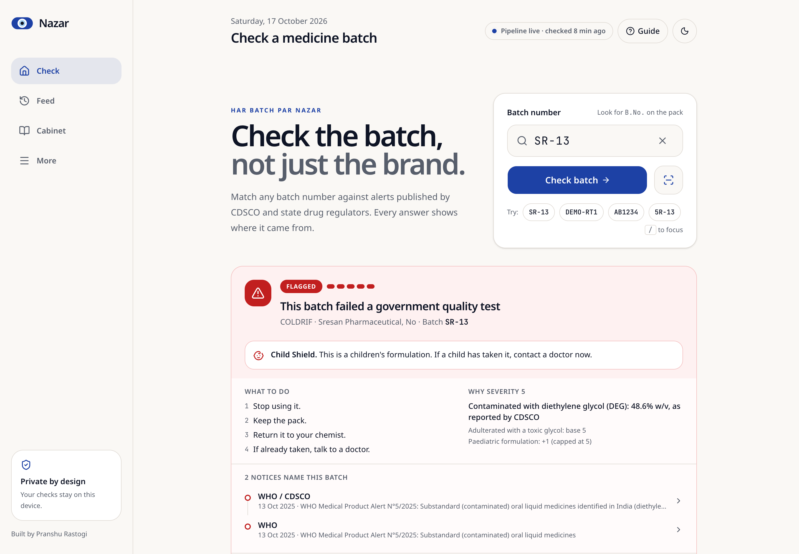

---

## The problem

India's drug regulators publish failed medicine batches as PDFs, tables and press notes, days apart, in formats no pharmacy billing software can read.

**The Coldrif case**
- **2 October 2025:** Tamil Nadu declared batch **SR-13** of COLDRIF syrup adulterated (48.6% w/v diethylene glycol), after clusters of child deaths.
- **13 October 2025:** WHO's Medical Product Alert N°5/2025 listed it with two more DEG-contaminated syrups, Respifresh TR (`R01GL2523`) and ReLife (`LSL25160`).
- Every state rewrote the same alert by hand, while the batch's printed expiry ran to April 2027.

Nazar turns those scattered notices into one live, verifiable feed that a chemist at the counter, a parent at 11 PM, or an AI agent can check in under three seconds.

> **Nazar never says a medicine is "safe".** It reports what a named regulator published, on which date, with the document. "No alert found" is shown in slate grey, never green, and always says it is not a safety certificate.

## Screenshots

**Live data**, from the pipeline run on 17 Oct 2026 against the real regulator sources:

| Home: high-severity alerts | A CDSCO NSQ batch | "How do we know?" |
|:---:|:---:|:---:|
| 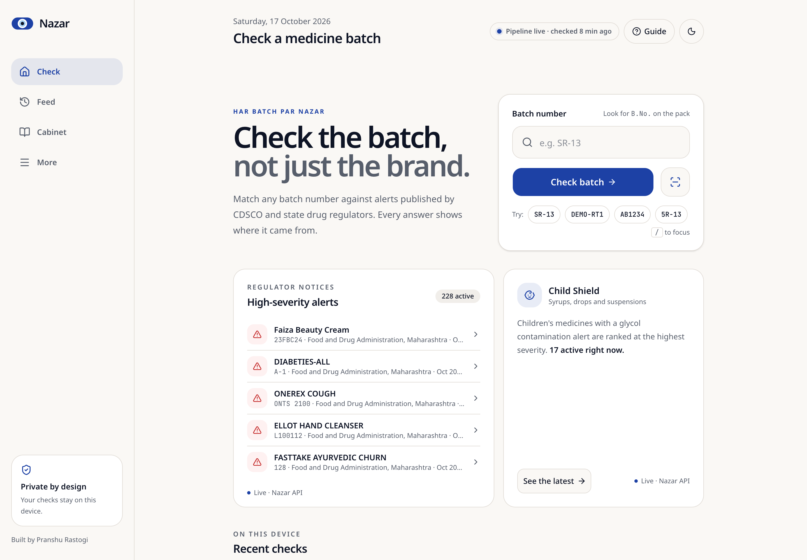 | 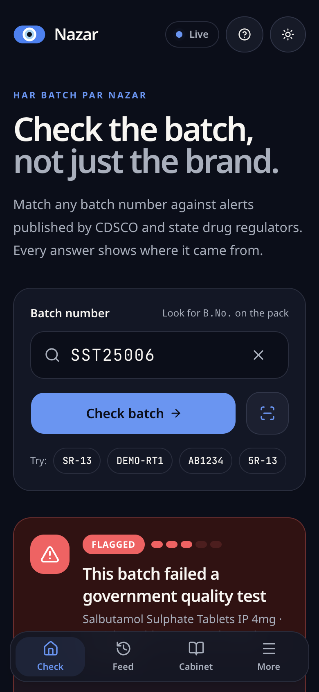 | 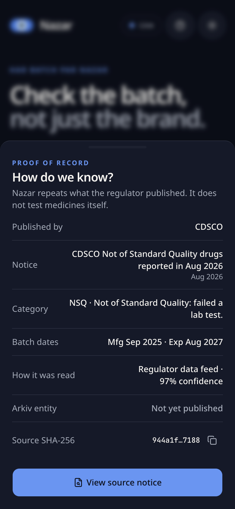 |

**First-run guide**, centred and animated:

| Desktop | Finding the batch number | Four honest answers |
|:---:|:---:|:---:|
| 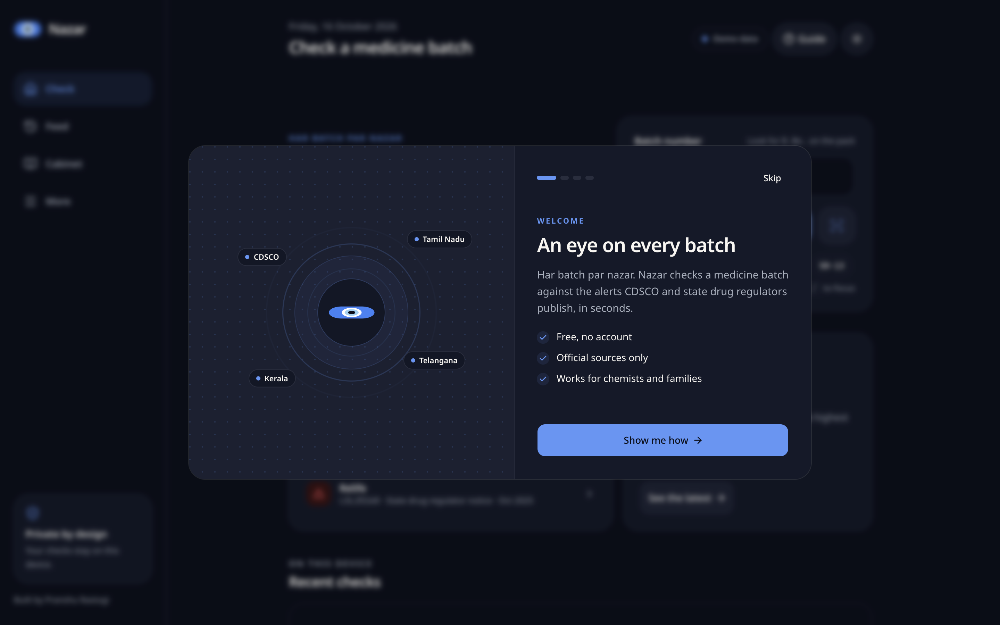 | 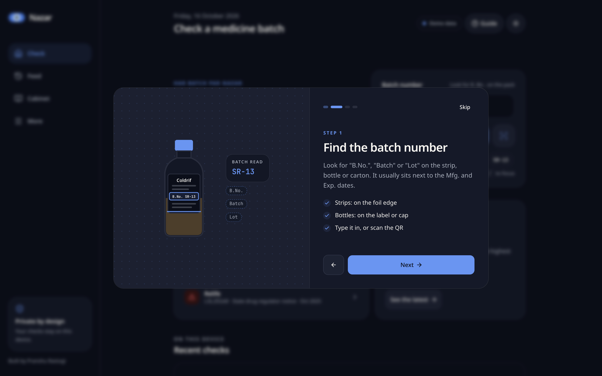 | 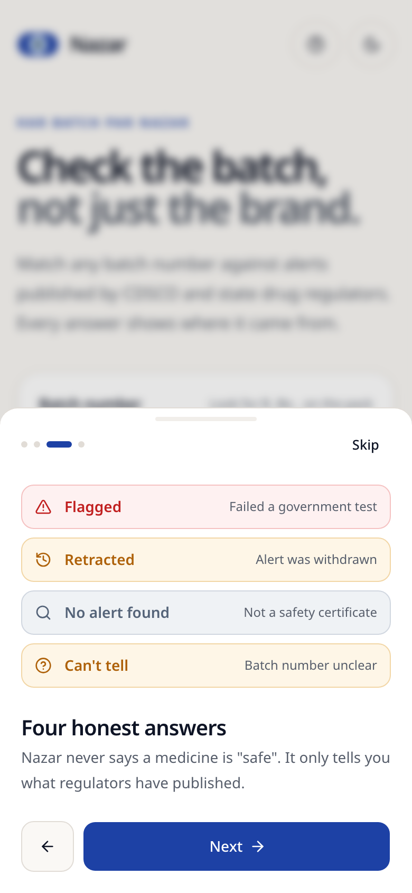 |

<details>
<summary>More screens (demo data, dark mode, no-alert state)</summary>

| Flagged result | Proof sheet | No alert found (dark) |
|:---:|:---:|:---:|
| 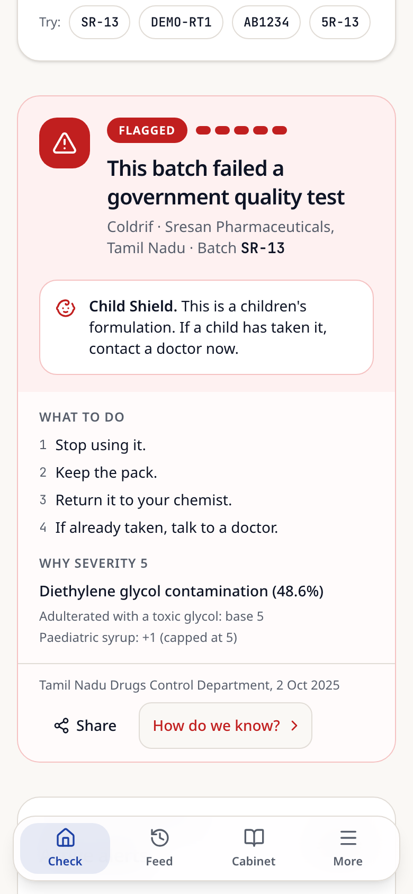 | 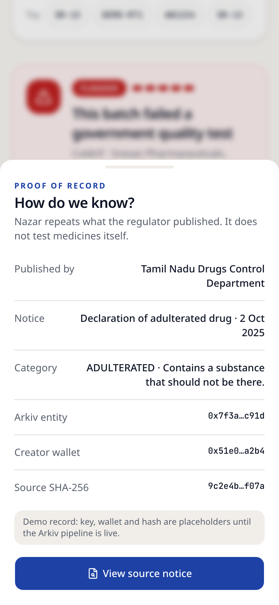 | 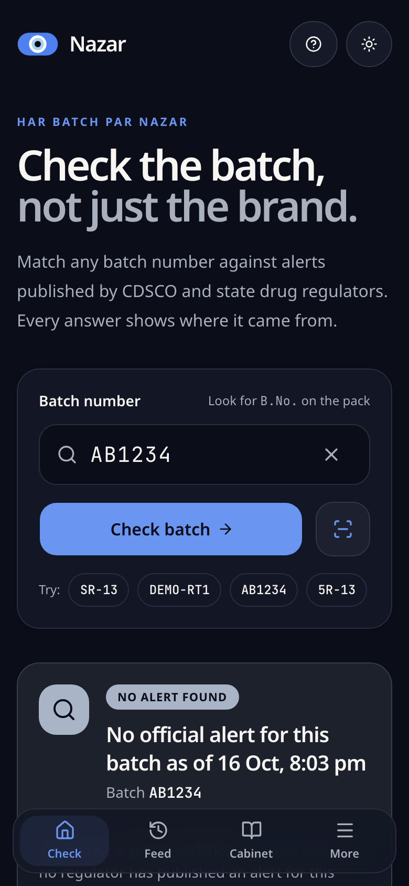 |

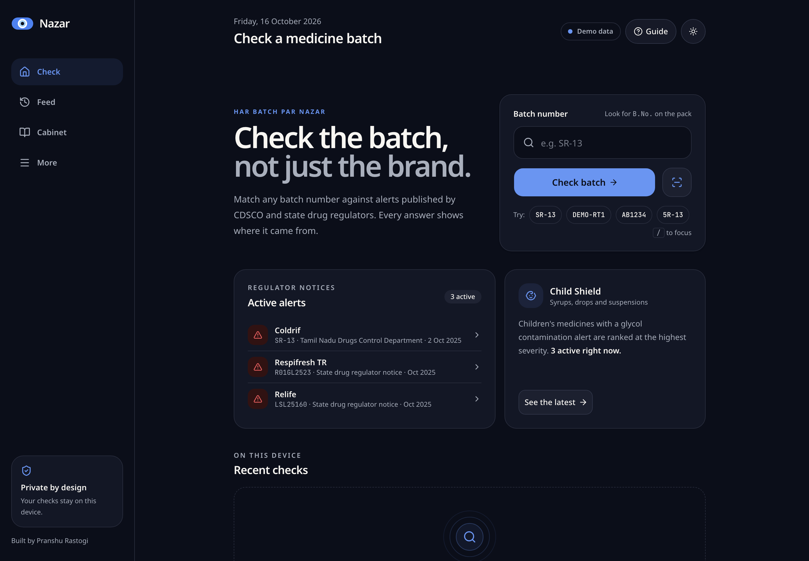

</details>

## Quick start

Requires Node 22.5+ (24 recommended) and pnpm 10.

```bash
# 1. Backend: harvest real alerts, then serve the API on :8787
cd Nazar-backend
pnpm install
cp .env.example .env && pnpm cli wallet:new     # prints only the address; the key stays in .env
pnpm cli run --since 202601 --limit 6           # discover → harvest → extract → resolve (dry-run publish)
pnpm start

# 2. Web app on :3000 (reads the API, then Arkiv directly, then demo data)
cd ../Nazar-frontend
pnpm install
cp .env.example .env.local
pnpm dev
```

### Try these batches

| Type this | You get | Where it comes from |
|---|---|---|
| `SR-13` | **Flagged**, severity 5, Child Shield, 2 notices | COLDRIF, WHO Medical Product Alert N°5/2025 (DEG 48.6% w/v) |
| `R01GL2523`, `LSL25160` | **Flagged**, severity 5 | Respifresh TR and ReLife, same WHO alert |
| `SST25006` | **Flagged** | Salbutamol tablets, CDSCO and Tamil Nadu NSQ lists, Aug 2026 |
| `5R-13` | **Can't tell**, "Did you mean SR-13?" | A look-alike is never shown as a flag |
| `AB1234` | **No alert found** | Not a safety certificate |
| `DEMO-RT1` | **Retracted** | Demo-only record |

## How it works

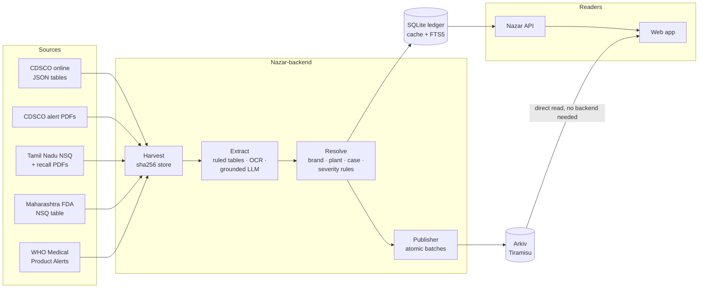

- **Truth on chain, caches off chain.** The ledger and search index can be deleted and rebuilt from Arkiv.
- **Content-addressed lineage.** Source bytes sha256 → row id → alert entity → case. Any alert traces back to the exact document.
- **Deterministic first, AI at the edges.** A table-geometry parser handles almost every row. An LLM sees only rejected rows, and every value it returns must appear in the source text.
- **No backend needed to check.** The web app queries Arkiv directly, filtered by the publisher's `$creator`, if the API is down.
- **Privacy by locality.** Batches you check stay on your device.

## The pipeline

[`Nazar-backend/`](Nazar-backend/README.md) is a TypeScript/Node 24 service. It has a CLI, a cron worker and a Hono API.

### Sources (live-verified)

| Source | Format | Notes |
|---|---|---|
| CDSCO online (`cdscoonline.gov.in`) | JSON tables | Monthly NSQ and spurious lists, 2019 onwards |
| CDSCO alerts (`cdsco.gov.in`) | PDF, text layer | 2024+ landscape and legacy portrait templates |
| Tamil Nadu Drugs Control | PDF, text layer | NSQ lists (columns change month to month) and recall notices |
| Maharashtra FDA | HTML table | Mixed date formats, flaky DNS (fallback IP) |
| WHO Medical Product Alerts | API + PDF annex | Only India-related alerts |
| Curated seed | JSON | Reviewed rows with source links, e.g. the Oct 2025 DEG syrups |
| Telangana, Karnataka, Kerala | not enabled | Off by default: geo-blocked outside India, or site down |

### Extraction

1. **Text layer first.** pdfjs reads text positions and **the table rules drawn in the PDF** to rebuild cells.
2. **Templates:** CDSCO modern, legacy, state and spurious; TN NSQ and recall; WHO annex; generic.
3. **OCR fallback.** Tesseract on rendered pages, with a batch-only re-read for rejected cells.
4. **LLM fallback.** Claude, grounded: only for rejected rows, and any value not found in the row text is dropped.

Rows are scored for confidence:

| Confidence | Result |
|---|---|
| ≥ 0.90 | auto-publish |
| 0.60–0.89 | "Machine-read, awaiting pharmacist confirmation" |
| below 0.60 | curator queue only |

### First full run (17 Oct 2026, from Kazakhstan)

| Source | Docs | Rows |
|---|---|---|
| cdsco-online | 6 | 811 |
| cdsco-pdf | 6 | 322 |
| tn-dc | 6 | 102 |
| mh-fda | 1 | 162 |
| who-mpa | 2 | 3 |
| curated | 1 | 3 |
| **Total** | **22** | **1,403** |

- 0 documents failed.
- 1,389 rows auto-publish, 13 are machine-read and 1 went to the curator queue.
- Severity distribution: 119 at 5, 109 at 4, 427 at 3, 594 at 2, 154 at 1.

```bash
pnpm cli sources | discover | harvest | extract <sha|file> | run | publish | check <batch> | status | heartbeat | worker
```

## Arkiv

Nazar uses Arkiv as its data layer. The full data contract is in [`arkiv/schema.md`](arkiv/schema.md), and building notes are in [`arkiv/friction.md`](arkiv/friction.md).

- **Publisher wallet:** `0xd06d85Eb20f126f796E4a341b711B1a757c66bD2` ([explorer](https://tiramisu.explorer.arkiv.network/address/0xd06d85Eb20f126f796E4a341b711B1a757c66bD2))
- **Live on Tiramisu since 18 Oct 2026:** **21 notices, 1,404 alerts and the pipeline heartbeat**, all created by the publisher, written in 106 atomic transactions for about 0.25 GLM. You can recount them with the query below.
  - First transactions: [WHO alert N°5/2025 notice + COLDRIF/Respifresh/ReLife](https://tiramisu.explorer.arkiv.network/tx/0x9f12a1ce1e9ea0e34e4f7026ee499c403327d9526d39e3d53b682dfd7d4f898c) and [curated seed](https://tiramisu.explorer.arkiv.network/tx/0x6a996737a022ef78d5f0dca83204793c260cea33c33410b8c761acfad0c96c9a).
  - Example SR-13 alert entity: [`0x346f83d7…80fe54`](https://tiramisu.explorer.arkiv.network/entity/0x346f83d7a8bed1003081605c0ad3bc76fa953b4eefea2c8a0cc9128ed180fe54). It is `readonly` and allows `permissionlessExtension`, with severity 5, `peds=1` and `exp_ym=202704`, and its `notice` attribute links to the WHO notice entity.
  - Heartbeat entity: [`0x00c58f01…268d`](https://tiramisu.explorer.arkiv.network/entity/0x00c58f01535a96bca043e9e2136c4ee46ec57c94a8938994d8791a28825b268d).
- **Live app:** <https://nazar-nu.vercel.app>. It reads these entities straight from Arkiv in the browser, with no Nazar server involved.
- **Live API and pipeline:** <https://nazar-api-production.up.railway.app> (`/health`, `/v1/check?batch=SR-13`) on Railway, Singapore. <sub>The region matters: CDSCO refuses connections from US cloud regions. It is pinned in [`.railway/railway.ts`](Nazar-backend/.railway/railway.ts). The server reports CDSCO reachability on `/health`, and an hourly [monitor](.github/workflows/monitor.yml) fails if that ever breaks.</sub> It harvests on schedule, publishes new notices and renews the heartbeat entity every 5 minutes. A fresh server rebuilt its ledger from the regulator sources and reconciled with Arkiv, adopting all 1,144 existing alerts by row id with zero duplicates.
- **Entities:** `notice`, `alert`, `retraction`, `heartbeat`, `snapshot`. Each carries `project=nazar-in-batch-alerts`, `t` and `v`.
- **Typed attributes for what we query:** `batch`, `sev`, `peds`, `exp_ym`, `alert_ym`, `state`, `case`, `rid`, `notice` (key)… Display detail goes in the JSON payload.
- **Lifetimes follow product logic.** An alert lives until the batch expires + 180 days, and a notice lives 5 years. A retraction lives for the alert's remaining life + 1 year. The heartbeat lives 20 minutes and is renewed every 5.
- **Flags:** alerts are `readonly` and allow `permissionlessExtension`. No one can rewrite an alert, but anyone can keep one alive while the batch is still on shelves.
- **Writes:** one atomic `executeBatch` per notice, using predicted keys so alerts link to their notice in the same transaction. Writes are idempotent by row id and serialised per wallet. Dry-run is the default and uses real gas estimation.
- **Reads:** always use `.createdBy(publisher)`. Example batch check:

```ts
client.select({ key: true, attributes: true, payload: true })
  .where(eq('project', str('nazar-in-batch-alerts')), eq('t', str('alert')), eq('batch', str('sr13')))
  .createdBy('0xd06d85Eb20f126f796E4a341b711B1a757c66bD2')
  .fetch()
```

## Tests

| Suite | What it covers | Run |
|---|---|---|
| Backend unit + golden | 241 tests. Domain rules, sources (real HTML/JSON fixtures), harvest, extraction golden files for every real PDF, resolve, publisher (dry-run, idempotency, chunking), reader, API, orchestrator | `cd Nazar-backend && pnpm test` |
| Backend live | Hits the real regulator sites (opt-in) | `pnpm test:live` |
| Frontend e2e | 68 checks in headless Chrome over CDP: onboarding, every result state, look-alikes, proof sheet, status pill, 360–430px layout, dark mode, reduced motion, console errors. Run with the API down (fallback) and with a mocked API | `cd Nazar-frontend && pnpm build && pnpm e2e` |

GitHub Actions:
- **CI**, on every push: backend typecheck and tests, frontend typecheck and build, and the e2e suite.
- **Pipeline**, every 6 hours: harvest, extract and publish. This is dry-run unless `NAZAR_PUBLISH_MODE=live` is set and the publisher key is in the repository secrets.

## Project structure

```
Nazar/
├── arkiv/                  schema.md (data contract), friction.md
├── Nazar-backend/          pipeline, Arkiv publisher/reader, API, CLI, worker
│   ├── src/{sources,pipeline,extract,resolve,arkiv,api,domain,storage,lib}
│   └── test/{unit,golden,fixtures,live}
├── Nazar-frontend/         Next.js 16 web app
│   ├── app/                check screen, layout, icons, manifest
│   ├── components/nazar/   onboarding (animated), result card, status pill
│   ├── lib/source/         API client, browser Arkiv reader, demo fallback, batch matching
│   └── e2e/                CDP end-to-end suite + runner
├── docs/screenshots/
└── .github/workflows/      ci.yml, pipeline.yml
```

**Stack:**
- **Frontend:** Next.js 16, React 19, Tailwind CSS v4, shadcn/ui on Base UI, Motion.
- **Backend:** Node 24, TypeScript, pdfjs-dist, tesseract.js, Hono, node:sqlite (FTS5), Zod.
- **Arkiv:** `@arkiv-network/sdk` 0.8 with viem.

## Roadmap

- [x] Batch check with four result states, severity reasons, Child Shield, look-alike guard
- [x] Animated first-run guide, proof sheet, private recent checks, dark mode
- [x] Real pipeline: CDSCO (API + PDFs), Tamil Nadu, Maharashtra, WHO; OCR and grounded LLM fallback
- [x] Arkiv data contract, publisher (atomic, idempotent), reader, heartbeat; dry-run verified with gas estimates
- [x] Web app reads the API, then Arkiv directly, then demo data
- [x] Fund the publisher wallet and publish live to Tiramisu (17 notices, 1,144 alerts, heartbeat)
- [ ] Telangana and Karnataka adapters from an Indian host; Kerala when its site is back
- [ ] Strip Scan (QR + on-device OCR), Batch Passport timeline, Keep Alive, Shelf Sweep CSV, MCP server
- [ ] Hindi and Kannada, then 10 languages with read-aloud

## Author

Built by **Pranshu Rastogi**.

## License

[MIT](LICENSE)
