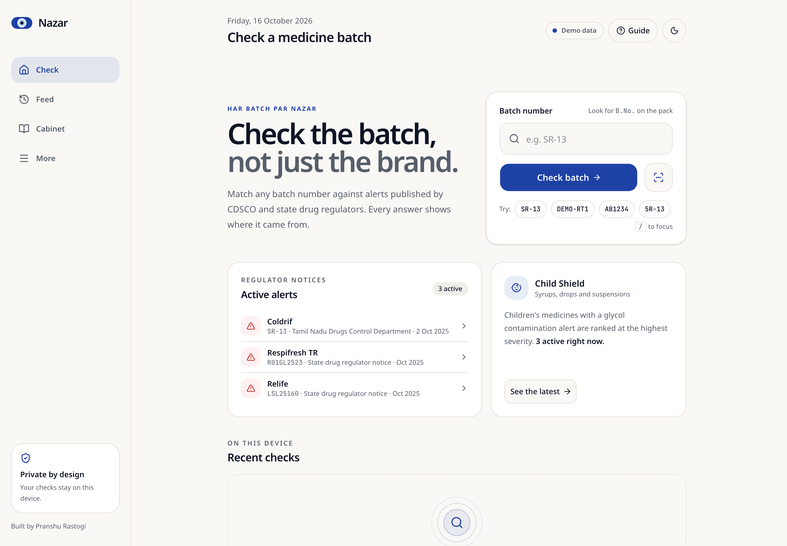
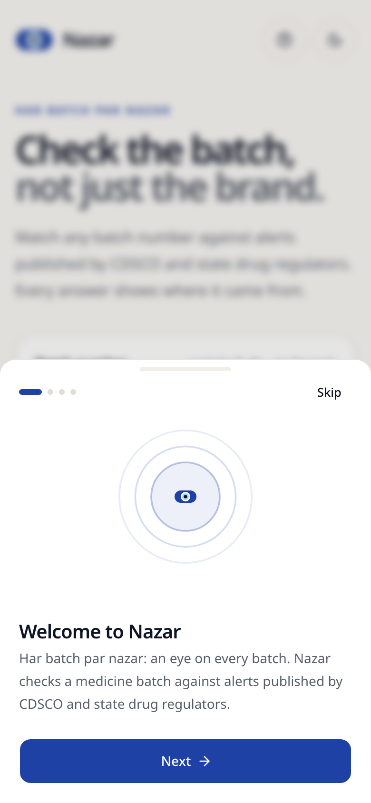
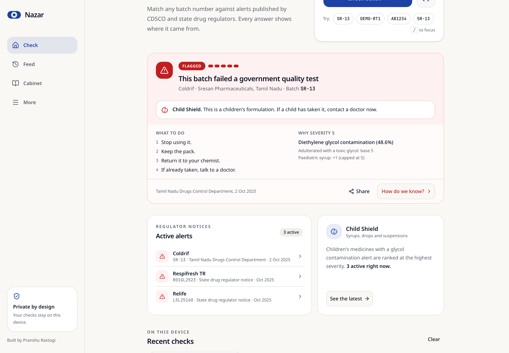
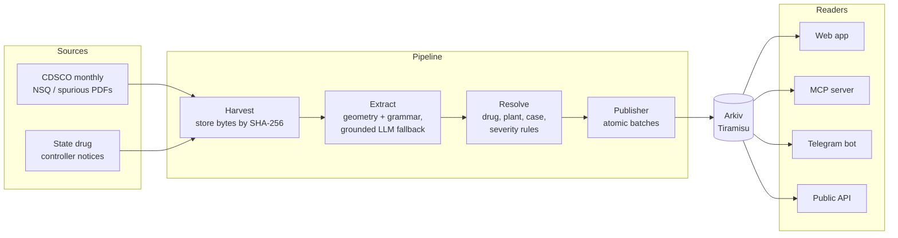

<div align="center">


# Nazar

**Har batch par nazar.** An eye on every batch.

Check any Indian medicine batch against CDSCO and state drug regulator alerts in seconds, with proof you can verify yourself.

[Quick start](#quick-start) · [Screenshots](#screenshots) · [How it works](#how-it-works) · [Arkiv data model](#arkiv-data-model) · [Roadmap](#roadmap)

</div>



---

## The problem

India's drug regulators publish failed medicine batches as PDFs and press notes, days apart, in formats no pharmacy billing software can read.

During the Coldrif crisis, Tamil Nadu declared batch **SR-13** adulterated on **2 October 2025** (48.6% diethylene glycol). Maharashtra issued its own notice on 6 October, and Telangana a separate stop-use notice. Every state rewrote the same alert by hand, and the batch's printed expiry runs to April 2027.

Nazar turns those scattered notices into one live, verifiable feed that a chemist at the counter, a parent at 11 PM, or an AI agent can check in under three seconds.

> **Nazar never says a medicine is "safe".** It reports what a named regulator published, on which date, with the document. "No alert found" is shown in slate grey, never green, and always says it is not a safety certificate.

## Screenshots

| First-run guide | Four honest answers | Flagged result |
|:---:|:---:|:---:|
|  |  |  |

| "How do we know?" proof | No alert found (dark) | Desktop result |
|:---:|:---:|:---:|
|  |  |  |

<details>
<summary>Dark mode on desktop</summary>


</details>

## Quick start

Requires Node 22+ and pnpm 10.

```bash
cd Nazar-frontend
pnpm install
pnpm dev          # http://localhost:3000
```

Production build:

```bash
pnpm build && pnpm start
pnpm typecheck    # tsc --noEmit
```

### Try these batches

The current build runs on a small demo data source, so you can see every result state:

| Type this | You get | Why |
|---|---|---|
| `SR-13` | **Flagged**, severity 5, Child Shield | Coldrif syrup, diethylene glycol adulteration |
| `R01GL2523`, `LSL25160` | **Flagged** | Respifresh TR and Relife, the related syrup alerts |
| `DEMO-RT1` | **Retracted** | A synthetic alert withdrawn after appeal |
| `AB1234` | **No alert found** | Any well-formed batch with no published alert |
| `5R-13` | **Can't tell**, "Did you mean SR-13?" | A look-alike is never shown as a flag |
| `!!` | **Can't tell** | Not a valid batch number |

## What's in this build

- **Batch check**: type a batch number (or press <kbd>/</kbd> to focus) and get one of four result states.
- **Four result states**: each has its own colour, icon and words, so colour never carries meaning alone.

  | State | Look | Headline |
  |---|---|---|
  | Flagged | Red, warning icon, severity 1 to 5 | This batch failed a government quality test |
  | Retracted | Amber, history icon | An alert on this batch was withdrawn |
  | No alert found | Slate, search icon | No official alert for this batch as of *date, time* |
  | Can't tell | Amber, question icon | We couldn't read the batch number clearly |

- **Severity with reasons**: the card shows which rules fired, for example "Adulterated with a toxic glycol: base 5", not just the number.
- **Child Shield**: children's formulations with glycol contamination get a banner telling parents to contact a doctor.
- **"How do we know?"**: a swipe-down sheet with the publishing authority, notice, category, Arkiv entity key, creator wallet and source PDF hash.
- **First-run guide**: four short steps covering where to find "B.No." on a pack, the four answers, and proof and privacy. Reopen it any time from **Guide** in the header.
- **Private recent checks**: kept in `localStorage` only, never uploaded.
- **Light and dark mode**, mobile bottom navigation, safe-area aware, 48px touch targets.
- **Share**: the native share sheet, or copies a summary to the clipboard.

> Entity keys, wallets and hashes in the proof sheet are placeholders until the Arkiv pipeline is live. The app labels them as such.

## How it works

Nazar is a one-way pipeline into [Arkiv](https://arkiv.network) plus a set of readers out of it. Arkiv is the source of truth; everything Nazar runs is a rebuildable cache.



Design principles:

- **Truth on chain, caches off chain.** Every Nazar database can be deleted and rebuilt from Arkiv.
- **Content-addressed lineage.** Source PDF hash → row ID → alert entity → case ID. Any alert traces back to the exact bytes it came from.
- **Deterministic first, AI at the edges.** A table-geometry parser and a label grammar handle most rows. An LLM sees only rejected rows, and every value it returns must appear in the source text.
- **Privacy by locality.** Stock files, medicine lists and photos are processed on the device, never on a server.
- **No backend needed to check.** The web app and MCP server can read Arkiv directly, so a check still works if every Nazar server is down.

## Arkiv data model

Every Arkiv feature Nazar uses changes something the user sees.

| Entity | Created by | Lifetime | Flags | What the user sees |
|---|---|---|---|---|
| `alert` | Publisher | Batch expiry + 180 days | readonly, permissionless extension | The alert disappears when the batch can no longer be sold; anyone can **Keep Alive** a batch still on shelves |
| `notice` | Publisher | 5 years | readonly | The source document behind every alert |
| `retraction` | Publisher or curator | Alert's life + 1 year | readonly | Corrections appear on the timeline instead of silent edits |
| `sighting` | Anyone | 30 days, extended by each confirmation | readonly, permissionless extension | "Still on shelves" reports by district |
| `roster` | Root wallet | 1-year lease | none | Only roster publishers show as official; anything else is labelled "Not from a listed publisher" |
| `snapshot` | Publisher | 7 days | readonly | The offline pack, verified by hash |
| `heartbeat` | Pipeline worker | 20 minutes, extended every 5 | none | "Pipeline live: CDSCO checked 4 minutes ago" |

Example query (batch check):

```ts
where(eq('app', 'nazar'), eq('t', 'alert'), eq('batch', 'sr13'))
```

Batch numbers are matched in a normalised form (`SR-13` → `sr13`). Characters that OCR and people commonly confuse (0/O, 1/I/L, 5/S, 8/B) can only produce a "Did you mean…?" prompt, never a flag.

## Project structure

```
Nazar/
├── README.md
├── docs/screenshots/          README images
└── Nazar-frontend/            Next.js 16 web app
    ├── app/
    │   ├── page.tsx           Check screen
    │   ├── layout.tsx         Fonts, theme, metadata
    │   ├── globals.css        Design tokens (incl. result-state colours)
    │   ├── icon.svg           Nazar mark
    │   ├── apple-icon.tsx     Generated Apple touch icon
    │   └── manifest.ts        Web app manifest
    ├── components/
    │   ├── nazar/             Logo, ring motif, onboarding, result card
    │   └── ui/                shadcn/ui components (Base UI)
    └── lib/
        └── mock-source.ts     Demo alerts and batch matching
```

**Stack:** Next.js 16, React 19, TypeScript, Tailwind CSS v4, [shadcn/ui](https://ui.shadcn.com) on Base UI, lucide icons, next-themes, sonner, Noto Sans and JetBrains Mono.

## Roadmap

- [x] Batch check with four result states, severity reasons and Child Shield
- [x] Proof sheet, first-run guide, private recent checks, dark mode
- [ ] Live data: Arkiv reader with the demo source kept as an automatic fallback, WebSocket feed, offline snapshot
- [ ] Strip Scan: QR decode, with on-device OCR as fallback
- [ ] Batch Passport timeline, live Feed and Keep Alive
- [ ] Shelf Sweep: match a pharmacy stock CSV in the browser, plus a bilingual Return Note
- [ ] MCP server (`check_batch`, `search_alerts`, `get_case`, `recent_alerts`)
- [ ] Hindi and Kannada, then all 10 languages with read-aloud

## Author

Built by **Pranshu Rastogi**.

## License

MIT
