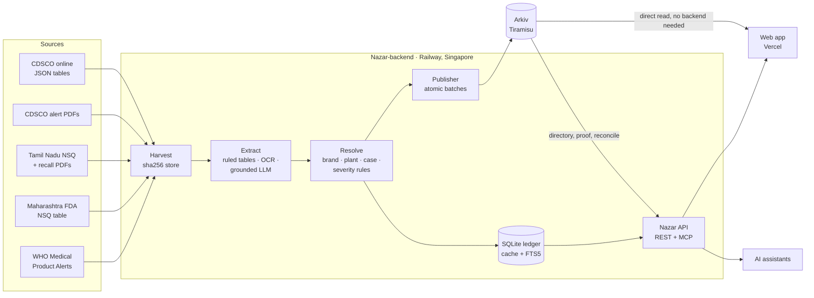

<div align="center">


# Nazar

**Har batch par nazar.** An eye on every batch.

Check any Indian medicine batch against CDSCO, state drug regulator and WHO alerts in seconds, with proof anyone can verify on Arkiv.

[](https://github.com/pranshurastogi/Nazar/actions/workflows/ci.yml)
[](https://github.com/pranshurastogi/Nazar/actions/workflows/pipeline.yml)
[](https://github.com/pranshurastogi/Nazar/actions/workflows/monitor.yml)
[](https://github.com/pranshurastogi/Nazar/actions/workflows/snapshot.yml)
[](LICENSE)

| | |
|---|---|
| **Web app** | **[nazar-nu.vercel.app](https://nazar-nu.vercel.app)** |
| **REST API** | [`https://nazar-api-production.up.railway.app`](https://nazar-api-production.up.railway.app/health) |
| **MCP server** | `https://nazar-api-production.up.railway.app/mcp` ([setup guide](https://nazar-nu.vercel.app/ai)) |
| **Data on Arkiv** | Tiramisu testnet, publisher [`0xd06d…6bD2`](https://tiramisu.explorer.arkiv.network/address/0xd06d85Eb20f126f796E4a341b711B1a757c66bD2) ([directory](https://nazar-nu.vercel.app/arkiv)) |

[Problem](#the-problem) · [What it does](#what-nazar-does) · [Features](#features) · [Screenshots](#screenshots) · [Try it](#try-it-in-60-seconds) · [**Use the data on Arkiv**](#use-the-data-on-arkiv-directly) · [**Use it from AI agents (MCP)**](#use-nazar-from-ai-agents-mcp) · [How it works](#how-it-works) · [Run it](#run-it-yourself) · [Tests](#tests-and-ci) · [Structure](#project-structure)

</div>

---

## The problem

India's drug regulators publish failed medicine batches as PDFs, tables and press notes, days apart, in formats no pharmacy billing software can read.

**The Coldrif case**
- **2 October 2025:** Tamil Nadu declared batch **SR-13** of COLDRIF syrup adulterated (48.6% w/v diethylene glycol), after clusters of child deaths.
- **13 October 2025:** WHO's Medical Product Alert N°5/2025 listed it with two more DEG-contaminated syrups, Respifresh TR (`R01GL2523`) and ReLife (`LSL25160`).
- Every state rewrote the same alert by hand, while the batch's printed expiry ran to April 2027.

Nazar turns those scattered notices into one live, verifiable feed that a chemist at the counter, a parent at 11 PM, or an AI agent can check in under three seconds.

## What Nazar does

You type the batch number from the pack (or scan it). Nazar answers with exactly one of four states:

| Answer | Colour | Meaning |
|---|---|---|
| **Flagged** | red | A named regulator listed this exact batch as not of standard quality, spurious, adulterated or misbranded. You get the notice, its date and the reason in the regulator's words. |
| **Retracted** | amber | An alert on this batch was withdrawn or corrected. The original stays on record. |
| **No alert found** | slate grey | No regulator alert Nazar reads names this batch yet. Always shown with "this is not a safety certificate". |
| **Can't tell** | amber | The batch could not be read, or only a look-alike matched (0/O, 1/I/L, 5/S, 8/B). It offers "Did you mean…?" and never a flag. |

> **Nazar never says a medicine is "safe".** It reports what a named regulator published, on which date, with the document. "No alert found" is never green.

Every result carries the chain of custody: regulator document → SHA-256 → Arkiv notice entity → this alert entity, created by Nazar's publisher wallet.


## Features

| Area | Feature | What it does |
|---|---|---|
| **Check & scan** | Check a batch | Four honest answers. "B.No. SR-13" works too: the label is stripped before matching. A watching eye looks at the batch box while you type, scans while checking, then turns red, amber or slate (never green). |
| | Strip Scan | Camera or photo. QR, Data Matrix and GS1 codes are decoded on the device (BarcodeDetector or zxing-wasm), with an OCR fallback for the printed "B.No." line. If the code and the printed batch disagree: "Label details don't match. Show this pack to your chemist." Images never leave the phone. |
| | Pack Reader | Reads the whole label on the device: product, composition, form, pack size, manufacturer and state, licence number, MRP and Schedule, each with an editable confidence. |
| | Severity with reasons | A versioned rule table, not a black box: "Adulterated with a toxic glycol: base 5 · Paediatric formulation: +1 (capped at 5)". |
| | Child Shield | Paediatric products at severity 4+ get a banner telling parents to contact a doctor now. |
| | About this medicine (opt-in) | Plain-language general information from a strictly validated Gemini answer, labelled *AI-generated · not from a regulator* and kept apart from the verdict. No doses, never "safe", the batch number is never sent. Rate-limited, with a daily cap. |
| **Feed & India pulse** | Feed | Every alert, newest first, with filters synced to the URL. Undated rows say "Date not given" and stay off the timeline. |
| | India pulse | A tile map of where failed batches were made, a monthly severity "seismograph" and headline counts. Tap a state to filter. |
| **Cabinet** | Your shelf, watched | Saved batches sit as capsules: red flagged, amber can't tell, slate no alert. They are re-checked every time you open the page, and expiring packs are marked. Stored only in your browser (export/import as JSON). |
| **Sharing** | Share a result | Every batch has a public page, `/b/SR-13`, with its own preview card for WhatsApp and social apps, the notice and the Arkiv proof. `/?batch=` links open a check directly. |
| **How it works** | The life of one alert | Six chapters following COLDRIF SR-13 from the WHO notice to your phone, with a scroll-driven chain of custody, then live source status, proof on Arkiv, privacy, settings and about. |
| **AI assistant** | `/ai` and the MCP server | A hosted, read-only MCP server lets Claude, ChatGPT, Cursor, VS Code and other assistants check batches with the same four answers. The [`/ai`](https://nazar-nu.vercel.app/ai) page has setup tabs per client and a demo replaying real answers. See [Use Nazar from AI agents](#use-nazar-from-ai-agents-mcp). |
| **Arkiv directory** | `/arkiv` | Everything Nazar has on chain: live counts and breakdowns, filters that turn into Arkiv predicates, the exact query string and an SDK snippet, attributes next to the payload, and a **From my browser** mode that queries Arkiv with no Nazar server involved. |
| **Offline & fallback** | It keeps working | A snapshot of every alert (about 57 KB compressed) lives on the device, so a check answers in about 15 ms and works offline, then the live API confirms it with the proof. See [the fallback chain](#the-fallback-chain). |
| | First-run guide | Where to find "B.No.", the four answers, and how the proof works. |

## Screenshots

| Check: the eye watches | Flagged: the eye turns red |
|:---:|:---:|
|  |  |

**Arkiv: every alert, verifiable by anyone.** The Nazar mark is rebuilt from GPU particles; move across it and it turns liquid, then settles back.

| At rest | Under the cursor |
|:---:|:---:|
|  |  |

| Arkiv directory | Filtered: Child Shield, severity 4+ | Entity: attributes vs payload |
|:---:|:---:|:---:|
|  |  |  |

**Feed: India pulse.** Where failed batches were made, and when. Tap a state to filter the list.


**Cabinet: your shelf, watched.**


**How it works: the life of one alert.**

| The story | The chain of custody |
|:---:|:---:|
|  |  |

**Share a result** and **About this medicine** (opt-in, AI-generated, kept apart from the verdict):

| Preview card for /b/SR-13 | The share page |
|:---:|:---:|
|  |  |


**On a phone:**

| Scanner | Pack Reader | QR scan | Label mismatch |
|:---:|:---:|:---:|:---:|
|  |  |  |  |

| Flagged | "How do we know?" | Shelf | How it works |
|:---:|:---:|:---:|:---:|
|  |  |  |  |

## Try it in 60 seconds

On **[nazar-nu.vercel.app](https://nazar-nu.vercel.app)**:

| Type this | You get | Where it comes from |
|---|---|---|
| `SR-13` (or `B.No. SR-13`) | **Flagged**, severity 5, Child Shield, 2 notices, on-chain proof | COLDRIF, WHO Medical Product Alert N°5/2025 (DEG 48.6% w/v) |
| `TG25-2281A` | **Flagged**, severity 5 | Levcon-M, CDSCO: spurious |
| `R01GL2523`, `LSL25160` | **Flagged**, severity 5 | Respifresh TR and ReLife, same WHO alert |
| `SST25006` | **Flagged** | Salbutamol tablets, CDSCO and Tamil Nadu NSQ lists |
| `(N)25567` | **Flagged** | Sodium chloride injection, CDSCO (batches with brackets are kept) |
| `5R-13` | **Can't tell**, "Did you mean SR-13?" | A look-alike is never shown as a flag |
| `AB1234` | **No alert found** | Not a safety certificate |

Then open **[/arkiv](https://nazar-nu.vercel.app/arkiv)**, set Child Shield + severity 4+, and watch the Arkiv query change. Or ask your AI assistant: *"Is batch SR-13 of Coldrif flagged?"* once you have [added the MCP server](#one-step-setup).

---

## Use the data on Arkiv directly

Nazar's database is public. Every alert Nazar publishes is an entity on [Arkiv](https://arkiv.network), and you can read all of it with the Arkiv SDK: **no Nazar account, key or server is needed**.

### Why Arkiv is the source of truth

- **Anyone can verify it.** Each alert is created by one publisher wallet and links to the regulator notice it came from, which stores the SHA-256 of the downloaded document.
- **Nobody can rewrite it.** Alerts are `readonly`, Nazar included. Corrections are new `retraction` entities, never silent edits.
- **Anyone can keep it alive.** Alerts allow `permissionlessExtension`: a chemist or an NGO can extend an alert while the batch is still on shelves.
- **Nazar's servers are only caches.** The SQLite ledger and search index can be rebuilt from Arkiv. A fresh server did exactly that: it adopted every published alert by row id and published zero duplicates.
- **Lifetimes follow product logic.** An alert lives until the batch expires + 180 days.

| | |
|---|---|
| **Network** | Arkiv Tiramisu testnet, chain `7738577`, RPC `https://rpc.tiramisu.db-chain.testnet.arkiv.network` |
| **Publisher (`$creator`)** | [`0xd06d85Eb20f126f796E4a341b711B1a757c66bD2`](https://tiramisu.explorer.arkiv.network/address/0xd06d85Eb20f126f796E4a341b711B1a757c66bD2) |
| **Project tag** | `project = "nazar-in-batch-alerts"` on every entity |
| **Live (18 Oct 2026)** | 21 `notice`, 1,404 `alert`, 1 `heartbeat` |
| **SDK** | [`@arkiv-network/sdk`](https://www.npmjs.com/package/@arkiv-network/sdk) `0.8.0` with `viem` |

**Always filter by all three:** `eq('project', …)`, `eq('t', …)` and `.createdBy(PUBLISHER)`. The first two keep other apps' data out. The third means an entity copied by someone else is never shown as official.

### Entity types

Every entity carries `project`, `t` (type) and `v` (schema version). What you query is a typed attribute; display detail is in the JSON payload. The full contract is in [`arkiv/schema.md`](arkiv/schema.md).

| `t` | One entity is | Key attributes | Payload | Lifetime, flags |
|---|---|---|---|---|
| `notice` | one regulator document | `src`, `juris`, `notice_ym`, `sha` (SHA-256 of the document), `rows`, `parser` | title, authority, URL, date | 5 years, `readonly` |
| `alert` | one batch named in a notice | `batch` (match key: `SR-13` → `sr13`), `batch_raw`, `sev` (1–5), `peds` (0/1), `cat`, `fail`, `form`, `state` (e.g. `IN-TN`), `mfg_ym`, `exp_ym`, `alert_ym`, `src`, `juris`, `notice` (key of the parent notice), `case`, `rid`, `brand`, `mfr`, `plant`, `conf`, `method`, `tier` | product, generic, manufacturer and its role, reason as printed, severity rules, notice title, URL, date and SHA-256 | batch expiry + 180 days; `readonly` + `permissionlessExtension` |
| `retraction` | a correction to an alert | `alert` (key), `case`, `reason`, `src` | note | alert's remaining life + 1 year, `readonly` |
| `heartbeat` | the pipeline's liveness lease | `worker`, `last_ok` (ms) | per-source last checks, alert count, version | 20 minutes, renewed every 5 |
| `snapshot` | daily pack of batch keys | `day`, `count`, `sha` | batch keys | 7 days, `readonly` (defined in the contract; none are live today) |

Months are `YYYYMM` integers (`202704`), so ranges work with `gte`/`lte`. Real entities read from the chain are in [`arkiv/examples/`](arkiv/examples): the [SR-13 alert](arkiv/examples/alert-sr13-coldrif.json), [its WHO notice](arkiv/examples/notice-who-mpa-n5-2025.json) and [the heartbeat](arkiv/examples/heartbeat.json).

### Copy-paste SDK examples

```bash
npm install @arkiv-network/sdk@0.8.0 viem
```

Shared setup for every example below:

```ts
import { createPublicClient } from '@arkiv-network/sdk'
import { i32, key, str } from '@arkiv-network/sdk/attr'
import { tiramisu } from '@arkiv-network/sdk/chains'
import { eq, gte } from '@arkiv-network/sdk/query'
import { http } from 'viem'

const PUBLISHER = '0xd06d85Eb20f126f796E4a341b711B1a757c66bD2'
const PROJECT = 'nazar-in-batch-alerts'
const client = createPublicClient({ chain: tiramisu, transport: http('https://rpc.tiramisu.db-chain.testnet.arkiv.network') })

/** The two filters every Nazar query starts with. */
const nazar = (t: 'notice' | 'alert' | 'retraction' | 'heartbeat') => [eq('project', str(PROJECT)), eq('t', str(t))]
/** Same normalisation as the app: "SR-13" → "sr13". Pass the batch alone, without "B.No.". */
const matchKey = (b: string) => b.toLowerCase().replace(/[^a-z0-9]/g, '')
```

**1. Check a batch** (the app's Q1):

```ts
const page = await client
  .select({ key: true, attributes: true, payload: true, creator: true })
  .where(...nazar('alert'), eq('batch', str(matchKey('SR-13'))))
  .createdBy(PUBLISHER)
  .limit(20)
  .fetch()

if (!page.entities.length) console.log('No alert found (not a safety certificate)')
for (const e of page.entities) {
  const p = e.toJson() as { product: string; reason: string; authority: string; noticeTitle: string; noticeUrl: string }
  console.log(e.key, p.product, '|', p.reason, '|', p.authority, p.noticeTitle, p.noticeUrl)
}
```

An exact query cannot suggest look-alikes: the "Did you mean…?" step (0/O, 1/I/L, 5/S, 8/B) is done by the app and the API. To see whether an alert was corrected, look for a retraction that points at it:

```ts
const fixes = await client.select({ key: true, attributes: true, payload: true })
  .where(...nazar('retraction'), eq('alert', key(page.entities[0].key)))
  .createdBy(PUBLISHER).fetch()
```

**2. Recent alerts for one state, with pinned pagination** (Q3):

```ts
const build = () =>
  client
    .select({ key: true, attributes: true, payload: true })
    .where(...nazar('alert'), gte('alert_ym', i32(202608)), eq('state', str('IN-TN')))
    .createdBy(PUBLISHER)
    .limit(200)

let page = await build().fetch()
const block = page.blockNumber          // pin every later page to this block
const alerts = [...page.entities]
while (page.hasNextPage() && page.cursor) {
  page = await build().atBlock(block).cursor(page.cursor).fetch()
  alerts.push(...page.entities)
}
// Arkiv returns no particular order: sort newest first yourself.
const ym = (e: (typeof alerts)[number]) => Number((e.attributes as Record<string, { value: unknown }>).alert_ym.value)
alerts.sort((a, b) => ym(b) - ym(a))
console.log(`${alerts.length} alert(s) for Tamil Nadu-made batches since Aug 2026, read at block ${block}`)
```

Child Shield (Q4) is the same shape: `eq('peds', i32(1)), gte('sev', i32(4))`. Batch Passport (Q5), every notice that named one batch: `eq('case', str(caseId))`.

**3. A notice and every alert linked to it** (Q7, then the `notice` key attribute):

```ts
const notices = await client.select({ key: true, attributes: true, payload: true })
  .where(...nazar('notice')).createdBy(PUBLISHER).limit(50).fetch()
const notice = notices.entities[0]
console.log((notice.toJson() as { title: string }).title)

const linked = await client.select({ key: true, attributes: true })
  .where(...nazar('alert'), eq('notice', key(notice.key)))
  .createdBy(PUBLISHER).limit(200).fetch()
console.log(`${linked.entities.length} alert(s) on the first page`)
```

**4. Is the pipeline alive?** (Q6). The heartbeat lives 20 minutes and is renewed every 5, so no heartbeat means the pipeline has stopped:

```ts
const hb = await client.select({ key: true, attributes: true, expiresAt: true })
  .where(...nazar('heartbeat')).createdBy(PUBLISHER).limit(5).fetch()
const lastOk = Number((hb.entities[0]?.attributes as Record<string, { value: unknown }> | undefined)?.last_ok?.value ?? 0)
console.log(hb.entities.length ? `last ok ${new Date(lastOk).toISOString()}` : 'no live heartbeat: the pipeline is paused')
```

**5. Verify one entity: is it really from Nazar?** Read it by key, straight from the chain:

```ts
const e = await client.getEntity('0x346f83d7a8bed1003081605c0ad3bc76fa953b4eefea2c8a0cc9128ed180fe54') // SR-13 alert
const attrs = e.attributes as Record<string, { value: unknown }>
console.log({
  official: e.creator?.toLowerCase() === PUBLISHER.toLowerCase(), // created by the Nazar publisher
  nazarProject: attrs.project?.value === PROJECT,                 // carries Nazar's project tag
  flags: e.creationFlags,                                         // readonly, permissionlessExtension
  expiresAtBlock: e.expiresAt,
})
```

`getEntity` throws `NoEntityFoundError` when the key never existed or has expired. This is the same check the MCP `arkiv_proof` tool runs.

### Pagination must pin the block

A cursor is only valid at the block where its first page was read. `page.next()` breaks as soon as a new block arrives, so always rebuild the query with `.atBlock(firstPage.blockNumber).cursor(page.cursor)`, as in example 2. To count consistently, pin the first page too: `.atBlock(await client.getBlockNumber())`. Background: [`arkiv/friction.md`](arkiv/friction.md).

### Raw query strings

The `/arkiv` page's query panel shows the exact text the Arkiv node parses (what the SDK's `toString()` renders). Check a batch:

```
project = str('nazar-in-batch-alerts') AND t = str('alert') AND batch = str('sr13') AND $creator = addr(0xd06d85Eb20f126f796E4a341b711B1a757c66bD2)
```

Child Shield, severity 4+:

```
project = str('nazar-in-batch-alerts') AND t = str('alert') AND sev >= i32(4) AND peds = i32(1) AND $creator = addr(0xd06d85Eb20f126f796E4a341b711B1a757c66bD2)
```

Alerts linked to a notice: `… AND t = str('alert') AND notice = key(0x…) AND $creator = addr(…)`.

### Runnable scripts

[`arkiv/queries/`](arkiv/queries) has one TypeScript file per query the app runs. The [Arkiv README](arkiv/README.md) is the deep reference.

```bash
cd arkiv/queries
npm install
npx tsx check-batch.ts SR-13        # Q1: 2 official alerts, severity 5, Child Shield
npx tsx feed.ts 202608 IN-TN        # Q3: since Aug 2026, Tamil Nadu-made, pinned pagination
npx tsx child-shield.ts             # Q4: paediatric, severity 4+
npx tsx notice-with-alerts.ts       # Q7: list notices; pass a notice key to list its alerts
npx tsx heartbeat.ts                # Q6: is the pipeline alive?
npx tsx count.ts                    # every entity type, counted at one block
```

The public RPC is rate limited. Set `ARKIV_API_KEY` (an access key from the Arkiv hub) if you hit HTTP 429.

### In the browser: `/arkiv` "From my browser"

The [Arkiv directory](https://nazar-nu.vercel.app/arkiv) has two run modes. **Via Nazar API** uses `GET /v1/arkiv/entities` (which itself reads Arkiv, never the ledger). **From my browser** sends the same query from your browser straight to the public Arkiv RPC, with no Nazar server involved. Each filter you set shows up in the query string and in a copyable SDK program, and every entity opens in a drawer with its creator, flags, expiry and attributes next to its payload.

---

## Use Nazar from AI agents (MCP)

Nazar runs a hosted [Model Context Protocol](https://modelcontextprotocol.io) server, so an assistant can answer "is this batch flagged?" with the same four states as the app, cite the regulator notice, and prove the alert on Arkiv.

```
https://nazar-api-production.up.railway.app/mcp
```

Streamable HTTP, **stateless** (no sessions; JSON responses, no SSE), **read-only**, **no sign-in or API key**. The full setup guide with a live demo is at **[nazar-nu.vercel.app/ai](https://nazar-nu.vercel.app/ai)**.

### What it gives an agent

- **Six read-only tools**: check a batch, search, the recent feed, the Batch Passport, the sources, and a live Arkiv proof.
- **Two resources** (`nazar://about`, `nazar://schema`) and **one prompt** (`check_my_medicine`).
- **Server instructions** that tell the model how to repeat answers honestly (below).
- Every alert comes with the regulator, notice title, date and URL, the severity rules that fired, and the Arkiv entity key and explorer link.

### One-step setup

| Client | Do this |
|---|---|
| **Claude Code** | Run once in a terminal: `claude mcp add --transport http nazar https://nazar-api-production.up.railway.app/mcp`. Then run `/mcp`: nazar should be listed as connected. |
| **Project `.mcp.json`** | Save the file below at a project's root, so everyone who opens it gets Nazar. Claude Code asks you to approve project servers the first time. |
| **Cursor** | Add to `~/.cursor/mcp.json` (or `.cursor/mcp.json` in one project). Cursor Settings → MCP shows nazar with its six tools. |
| **VS Code** | Add `.vscode/mcp.json` to your workspace, start the server from the file, then ask in Copilot Chat in Agent mode. |
| **Claude Desktop and claude.ai** | Settings → Connectors → Add custom connector → paste the endpoint URL. |
| **ChatGPT** | Settings → Apps & Connectors → Advanced → turn on Developer mode → Create connector → paste the URL, with no authentication. |

`.mcp.json`:

```json
{
  "mcpServers": {
    "nazar": {
      "type": "http",
      "url": "https://nazar-api-production.up.railway.app/mcp"
    }
  }
}
```

`~/.cursor/mcp.json`:

```json
{
  "mcpServers": {
    "nazar": {
      "url": "https://nazar-api-production.up.railway.app/mcp"
    }
  }
}
```

`.vscode/mcp.json`:

```json
{
  "servers": {
    "nazar": {
      "type": "http",
      "url": "https://nazar-api-production.up.railway.app/mcp"
    }
  }
}
```

### Tools

| Tool | Use it for | Inputs | Sample output (first line, live server) |
|---|---|---|---|
| `check_batch` | Is this batch named in an official alert? | `batch` (string, as printed, e.g. `SR-13`) | `FLAGGED: batch SR-13 is named in 2 official regulator alert(s) (as of 2026-10-18 11:52 UTC).` |
| `search_alerts` | Alerts mentioning a brand, product, generic, maker or reason | `query` (2–100 chars), `limit?` (1–50, default 10) | `2 alert(s) matching "coldrif":` |
| `recent_alerts` | What has been flagged lately | `minSeverity?` (1–5), `childShield?` (bool), `state?` (`IN-TN`), `source?` (`cdsco-online`), `limit?` (1–50) | `2 of 17 alert(s), newest first:` (with `childShield: true`) |
| `get_case` | Batch Passport: every notice that named the same batch | `caseId` (hex, from another result) | `Batch Passport for SR-13: named in 2 notice(s).` |
| `list_sources` | Which regulators Nazar reads, on or off, last checked | none | `9 sources:` then `- cdsco-online: CDSCO (IN), enabled, last checked …` |
| `arkiv_proof` | Prove an alert is genuine and unaltered, read live from Arkiv | `entityKey` (`0x` + 64 hex, the `arkiv.entityKey` of an alert) | `OFFICIAL: a live Nazar alert created by the Nazar publisher wallet 0xd06d…6bD2, read directly from Arkiv at block 737375.` |

Each tool returns a short text answer plus `structuredContent`. For `check_batch` that is `state` (`flagged` / `retracted` / `no_alert` / `unreadable`), `batch`, `asOf`, `answeredFrom`, the `alerts` (brand, product, manufacturer, reason, severity and rules, Child Shield, regulator, notice, `arkiv.entityKey` and explorer link, `caseId`), a `suggestion` for look-alikes, and links to the app and the Arkiv directory.

**Resources:** `nazar://about` (what Nazar is, the four answers, how severity is scored, what is out of scope) and `nazar://schema` (the Arkiv data contract in brief). **Prompt:** `check_my_medicine` (optional `medicine` argument) walks a person through finding "B. No." on the pack, typing it exactly, and reading the answer honestly.

### The rules the server gives the model

The server sends these as its MCP `instructions` (verbatim in [`Nazar-backend/src/mcp/server.ts`](Nazar-backend/src/mcp/server.ts)):

1. Exactly one of four states. Report it as given; never upgrade or soften it.
2. Never say a medicine is "safe", "genuine", "fine" or "approved". "No alert found" is not a safety certificate.
3. When flagged, name the regulator, the notice title and date, link the notice and the Arkiv entity, and give the reason in the regulator's words. Advise: stop using it, keep the pack, return it to the chemist, see a doctor if it was taken.
4. A "did you mean" suggestion is never a flag: ask the person to re-read the pack.
5. The same batch number can be used by different makers: confirm the brand and manufacturer on the pack match.
6. Use `arkiv_proof` to show the alert can be verified without trusting Nazar.
7. Out of scope: general medicine information, dosing and medical advice.

### A worked example

> **User:** Is batch SR-13 of Coldrif safe for my child?

The agent calls `check_batch({ "batch": "SR-13" })` and gets (trimmed):

```text
FLAGGED: batch SR-13 is named in 2 official regulator alert(s) (as of 2026-10-18 11:52 UTC).
- COLDRIF (paracetamol, chlorpheniramine maleate, phenylephrine, sodium citrate) (batch SR-13) | Sresan Pharmaceutical | Adulterated: Contaminated: 48.6% w/v DEG | severity 5/5, Child Shield | WHO, "WHO Medical Product Alert N°5/2025: Substandard (contaminated) oral liquid medicines" (2025-10-13) https://cdn.who.int/… | Arkiv https://tiramisu.explorer.arkiv.network/entity/0x346f83d7…80fe54
- … (the same batch in the WHO / CDSCO curated notice)
Confirm the brand and manufacturer on the pack match. If they do: stop using it, keep the pack, return it to the chemist, and see a doctor if it was taken.
```

> **Agent:** **Flagged.** Batch SR-13 of COLDRIF is named in 2 official regulator alerts. WHO listed it in Medical Product Alert N°5/2025 (13 Oct 2025) as adulterated: "Contaminated: 48.6% w/v DEG". The maker on the alert is Sresan Pharmaceutical. Severity 5/5, with Child Shield because it is a children's medicine. First check that the brand and manufacturer on your pack match. If they do: stop giving it, keep the pack, return it to the chemist, and see a doctor if your child has taken it. Notice: [WHO PDF] · Proof: [Arkiv entity]. This is not medical advice.

For independent verification, the agent then calls `arkiv_proof({ "entityKey": "0x346f83d7a8bed1003081605c0ad3bc76fa953b4eefea2c8a0cc9128ed180fe54" })`. It reads the entity live from Arkiv with `getEntity`, never from Nazar's database, and returns its attributes, payload, creator, whether that creator is the Nazar publisher, its flags and its expiry. The verdict is `OFFICIAL`, `NOT NAZAR` (no project tag), `NOT OFFICIAL` (the tag copied by another wallet) or `NOT FOUND` (never existed, or expired).

### Test it from a terminal

The server is stateless, so any single JSON-RPC call works on its own. The `Accept` header must list both types (the server completes it for clients that send only one).

```bash
# initialize: server info and the instructions
curl -s https://nazar-api-production.up.railway.app/mcp \
  -H 'content-type: application/json' \
  -H 'accept: application/json, text/event-stream' \
  -d '{"jsonrpc":"2.0","id":1,"method":"initialize","params":{"protocolVersion":"2025-06-18","capabilities":{},"clientInfo":{"name":"curl","version":"0"}}}'

# tools/list
curl -s https://nazar-api-production.up.railway.app/mcp \
  -H 'content-type: application/json' \
  -H 'accept: application/json, text/event-stream' \
  -d '{"jsonrpc":"2.0","id":2,"method":"tools/list"}'

# tools/call check_batch: the reply should start with "FLAGGED: batch SR-13"
curl -s https://nazar-api-production.up.railway.app/mcp \
  -H 'content-type: application/json' \
  -H 'accept: application/json, text/event-stream' \
  -d '{"jsonrpc":"2.0","id":3,"method":"tools/call","params":{"name":"check_batch","arguments":{"batch":"SR-13"}}}'
```

With the MCP Inspector CLI:

```bash
npx -y @modelcontextprotocol/inspector@0.17.2 --cli https://nazar-api-production.up.railway.app/mcp --transport http --method tools/list
npx -y @modelcontextprotocol/inspector@0.17.2 --cli https://nazar-api-production.up.railway.app/mcp --transport http --method tools/call --tool-name check_batch --tool-arg batch=SR-13
```

If something looks off: opening the URL in a browser returns **405** (expected: only POST is answered). If a client asks for OAuth, choose no authentication. If tools do not show up, check the URL ends in `/mcp` and restart the client.

### Limits and privacy

- **Read-only.** Every tool is annotated read-only; nothing can be written through the server.
- **No personal data.** No account, sign-in or key. Nazar receives only tool arguments (a batch number, search words or an id), never the conversation. Logs keep the tool name, outcome and duration, never the arguments.
- **Limits:** 60 tool calls per minute and 240 requests per minute per client, where a client is a salted hash of its IP held in memory; request bodies up to 64 KB. Over the limit, a tool answers "Rate limited … try again in N s".
- **Not exposed:** the app's AI medicine explainer and pack identification. Dosing and medical questions belong with a pharmacist or doctor.

### Without MCP: the REST API and the snapshot file

Agents and scripts can call the same API the app uses. `GET /v1/check` and the MCP `check_batch` tool share one code path and cache.

```bash
curl -s 'https://nazar-api-production.up.railway.app/v1/check?batch=SR-13' | jq '{state, batch, alerts: [.alerts[] | {brand, authority, noticeTitle, severity, entityKey}]}'
```

The response has `state`, `batch`, `asOf`, `alerts`, an optional `suggestion` (look-alike, never a flag) and `source` (`ledger`, or `arkiv` when the ledger had nothing and the API read Arkiv). Browser CORS on `/v1/*` is limited to Nazar's own web origins; call it from a server, script or agent, or read Arkiv directly from a browser.

| Endpoint | Returns |
|---|---|
| `GET /health` | version, mode, publisher, chain id, ledger stats, egress check (region, CDSCO reachability) |
| `GET /v1/check?batch=SR-13` | the four-state answer with alerts; "B.No." labels are stripped |
| `GET /v1/alerts?limit=&offset=&state=&minSeverity=&peds=&sinceYm=&source=&productClass=` | the feed, newest first, `{ items, total }`; `productClass` is `medicine`, `cosmetic` or `hygiene` |
| `GET /v1/alerts/:rid` | one alert |
| `GET /v1/search?q=&limit=` | full-text search over brand, product, generic, manufacturer and reason |
| `GET /v1/cases/:caseId` | Batch Passport |
| `GET /v1/notices?limit=`, `GET /v1/sources` | regulator documents (with Arkiv keys), source adapters and last runs |
| `GET /v1/snapshot` | every publishable alert in one compressed file (the app's on-device copy) |
| `GET /v1/pipeline/status` | heartbeat, recent runs, wallet balance |
| `GET /v1/arkiv/summary` | live entity counts and breakdowns, read from Arkiv |
| `GET /v1/arkiv/entities?type=&batch=&state=&sevMin=&peds=&notice=&…&cursor=&block=` | one page of entities straight from Arkiv, with pinned-block paging |
| `POST /v1/medicine/explain` | "About this medicine" general information (opt-in in the app; rate-limited) |
| `POST /v1/medicine/identify` | a guess of the medicine from OCR'd label text (text only, never the image; rate-limited) |
| `POST /mcp` | the MCP server |

**Daily snapshot file.** The whole publishable alert set is also a static file: [`nazar-nu.vercel.app/data/snapshot.json`](https://nazar-nu.vercel.app/data/snapshot.json), refreshed daily by GitHub Actions and on every build. It is compact by design (arrays, not objects); the row format is documented in [`Nazar-backend/src/api/snapshot.ts`](Nazar-backend/src/api/snapshot.ts). It leaves out entity keys, so use Arkiv or the API for proof.

---

## How it works



- **Truth on chain, caches off chain.** The ledger and search index can be rebuilt from Arkiv.
- **Content-addressed lineage.** Source bytes SHA-256 → row id → alert entity → case. Any alert traces back to the exact document.
- **Deterministic first, AI at the edges.** A table-geometry parser handles almost every row. An LLM sees only rejected rows, and every value it returns must appear in the source text.
- **Privacy by locality.** Checks, the cabinet and photos stay on your device.

### The pipeline

[`Nazar-backend/`](Nazar-backend/README.md) is a TypeScript/Node 24 service with a CLI, a cron worker and a Hono API.

```
discover → harvest → extract → resolve → publish → Arkiv
```

| Stage | What happens |
|---|---|
| **Discover** | One adapter per regulator finds new documents. |
| **Harvest** | Polite fetching (per-host delay, robots.txt, timeouts, size caps); bytes stored by SHA-256. |
| **Extract** | pdfjs text layer plus the table rules drawn in the PDF; templates for CDSCO, Tamil Nadu and the WHO annex; Tesseract OCR fallback; a grounded Claude fallback only for rejected rows. |
| **Resolve** | Brand vs generic, manufacturer and plant (state from the PIN code), one case per batch across notices, severity from a versioned rule table. |
| **Publish** | One atomic `executeBatch` per notice with predicted keys, so alerts link to their notice in the same transaction. Idempotent by row id, reconciled with Arkiv before sending. |

| Confidence | Result |
|---|---|
| ≥ 0.90 | auto-publish |
| 0.60–0.89 | published as "Machine-read, awaiting pharmacist confirmation" |
| below 0.60 | curator queue only |

Rows with no printed batch become drug-level records that can never match a batch check.

**Sources (live-verified):**

| Source | Format | Notes |
|---|---|---|
| CDSCO online (`cdscoonline.gov.in`) | JSON tables | Monthly NSQ and spurious lists, 2019 onwards |
| CDSCO alerts (`cdsco.gov.in`) | PDF, text layer | 2024+ landscape and legacy portrait templates |
| Tamil Nadu Drugs Control | PDF, text layer | NSQ lists (columns change month to month) and recall notices |
| Maharashtra FDA | HTML table | Mixed date formats, flaky DNS (fallback IP) |
| WHO Medical Product Alerts | API + PDF annex | Only India-related alerts |
| Curated seed | JSON | Reviewed rows with source links, e.g. the Oct 2025 DEG syrups |
| Telangana, Karnataka, Kerala | not enabled | Geo-blocked outside India, or site down |

**What the live server holds (18 Oct 2026):** 23 documents from 6 sources, 1,438 rows, **1,404 alerts published to Arkiv** (21 notices), 32 drug-level records, 9 rows in the curator queue, 0 failed documents. See [`/health`](https://nazar-api-production.up.railway.app/health).

### How it stays up to date

No one is in the loop. A new notice is fetched, read, resolved and published to Arkiv on a schedule.

| Where | What | When |
|---|---|---|
| Railway worker | CDSCO sources | every 6 hours (`NAZAR_CRON_CDSCO`) |
| Railway worker | State regulators and WHO | every 3 hours (`NAZAR_CRON_STATES`) |
| Railway worker | Renew the heartbeat entity on Arkiv | every 5 minutes (`NAZAR_CRON_HEARTBEAT`) |
| GitHub Actions: **CI** | Backend typecheck and tests, frontend typecheck, scanner tests and build, then the e2e suite | every push |
| GitHub Actions: **Pipeline** | Harvest, extract and publish (dry-run unless `NAZAR_PUBLISH_MODE=live` and the key are in the repo secrets) | every 6 hours |
| GitHub Actions: **Monitor** | Fails (and emails the owner) if the API is down, CDSCO is unreachable from the server's region, the heartbeat is stale, or SR-13 stops being flagged | hourly |
| GitHub Actions: **Refresh saved snapshot** | Fetches the API snapshot into `Nazar-frontend/public/data/snapshot.json` and commits it only if it changed, which redeploys the site | daily |

Each run reconciles with Arkiv before sending, so nothing is published twice. Every request, document and source has a hard deadline, so one slow government site can't stall a run.

### The fallback chain

Every check tries, in order, and the answer always says which source it came from:

1. **Nazar API** (cached at Vercel's edge through the same-origin `/api/nazar/*` rewrite).
2. **Arkiv, from the browser**, filtered by the publisher's `$creator`. No Nazar server needed.
3. **Nazar's saved copy**: the snapshot kept on the device, else the site's own `/data/snapshot.json`.
4. **Demo data**, only offline on a first visit with none of the above.

When a saved copy is loaded, it answers instantly first and the live source then confirms or corrects the card.

## Run it yourself

Requires Node 22.5+ (24 recommended) and pnpm 10.

```bash
# 1. Backend: harvest real alerts, then serve the API (and /mcp) on :8787
cd Nazar-backend
pnpm install
cp .env.example .env && pnpm cli wallet:new     # prints only the address; the key stays in .env
pnpm cli run --since 202601 --limit 6           # discover → harvest → extract → resolve (dry-run publish)
pnpm start                                      # API on http://localhost:8787
pnpm worker                                     # optional: the cron worker

# 2. Web app on :3000 (API, then Arkiv directly, then the saved copy, then demo data)
cd ../Nazar-frontend
pnpm install
cp .env.example .env.local
pnpm dev
```

To publish for real: fund the publisher at <https://hub.arkiv.network/faucet>, run `pnpm cli arkiv:validate`, then `pnpm cli publish --live`. More CLI commands: [`Nazar-backend/README.md`](Nazar-backend/README.md#quick-start).

**Environment (names only; see each `.env.example`):**

| Variable | Where | Purpose |
|---|---|---|
| `ARKIV_RPC_URL`, `ARKIV_WS_URL`, `ARKIV_CHAIN_ID`, `ARKIV_EXPLORER_URL` | backend | Arkiv network |
| `ARKIV_API_KEY` | backend | optional Arkiv access key (higher rate limits) |
| `NAZAR_PUBLISHER_PRIVATE_KEY` | backend | **secret**: the publisher wallet, written by `pnpm cli wallet:new` |
| `NAZAR_PUBLISH_MODE` | backend | `dry-run` (default) or `live` |
| `NAZAR_SOURCES`, `NAZAR_HOST_DELAY_MS`, `NAZAR_HTTP_TIMEOUT_MS`, `NAZAR_DOC_TIMEOUT_MS`, `NAZAR_SOURCE_TIMEOUT_MS` | backend | which sources run, politeness and deadlines |
| `NAZAR_OCR_ENABLED`, `NAZAR_OCR_LANG` | backend | OCR fallback |
| `ANTHROPIC_API_KEY`, `NAZAR_LLM_MODEL` | backend | **secret** key for the grounded extraction fallback (optional) |
| `NAZAR_LLM_PROVIDER`, `GEMINI_API_KEY`, `NAZAR_GEMINI_MODEL`, `NAZAR_LLM_DAILY_CAP`, `NAZAR_LLM_IDENTIFY_DAILY_CAP` | backend | "About this medicine" and identify (**secret** key) |
| `NAZAR_IP_SALT` | backend | salt for rate-limit IP hashes (random per boot when empty) |
| `NAZAR_CRON_CDSCO`, `NAZAR_CRON_STATES`, `NAZAR_CRON_HEARTBEAT` | backend | worker schedules |
| `NAZAR_ROLE`, `NAZAR_RUN_ON_START`, `PORT`, `NAZAR_CORS_ORIGINS` | backend | process role (`api`, `worker` or `all`), first run, port, CORS |
| `NEXT_PUBLIC_NAZAR_API_URL` | frontend | the API URL (optional; tried first) |
| `NEXT_PUBLIC_ARKIV_RPC_URL`, `NEXT_PUBLIC_NAZAR_PUBLISHER` | frontend | browser Arkiv reads and the only trusted `$creator` |
| `NAZAR_API_ORIGIN` | frontend (server) | routes the browser through the same-origin `/api/nazar/*` rewrite, cached at the edge |

**Deploy:**
- **Backend:** Railway, Fly.io or any Docker host. See [`Nazar-backend/docs/deploy.md`](Nazar-backend/docs/deploy.md). The live service runs on Railway in **Singapore** because CDSCO refuses connections from US cloud regions; the region is pinned in [`.railway/railway.ts`](Nazar-backend/.railway/railway.ts). One replica only: one publisher wallet means one writer.
- **Web app:** Vercel, with the frontend variables above.

## Tests and CI

| Suite | What it covers | Run |
|---|---|---|
| Backend unit + golden | **415 tests.** Domain rules, sources (real HTML/JSON fixtures), harvest, extraction golden files for every real PDF, resolve, publisher (dry-run, idempotency, chunking, catch-up), reader, Arkiv directory, snapshot and caches, medicine explainer and identify (schema, guardrails, limits), API, MCP server (tools, stateless HTTP round trip, limits), watchdogs, egress check, secret redaction | `cd Nazar-backend && pnpm test` |
| Scanner parsers | **22 tests**: GS1 element strings and Digital Links, pack key-value text, full pack labels, noise | `cd Nazar-frontend && pnpm test:scan` |
| Frontend e2e | **445 checks** (303 with the API down, 142 with a mocked API) in headless Chrome over CDP: onboarding, every result state, look-alikes, the watching eye, the proof sheet, sharing and `/b/` pages, the saved-copy fallback, Feed and India pulse, the Cabinet, How it works, the AI page, the Arkiv directory, Strip Scan, 360–430 px layouts, dark mode, reduced motion and console errors | `cd Nazar-frontend && pnpm build && pnpm e2e` |
| Backend live | Hits the real regulator sites (opt-in) | `cd Nazar-backend && pnpm test:live` |

CI runs all of them except the live suite on every push. The scheduled workflows are listed under [How it stays up to date](#how-it-stays-up-to-date).

## Project structure

```
Nazar/
├── arkiv/                  README, schema.md (data contract), friction.md, examples/ (real entities), queries/ (runnable)
├── Nazar-backend/          pipeline, Arkiv publisher/reader/directory, REST API, MCP server, CLI, worker
│   ├── src/{sources,pipeline,extract,resolve,arkiv,api,mcp,medicine,domain,storage,config,lib}
│   ├── .railway/railway.ts Railway infrastructure as code (Singapore)
│   ├── Dockerfile, fly.toml, render.yaml, docs/deploy.md
│   └── test/{unit,golden,fixtures,live}
├── Nazar-frontend/         Next.js 16 web app
│   ├── app/(main)/         check (/), feed, cabinet, arkiv, ai, more (How it works)
│   ├── app/b/[batch]/      public share pages
│   ├── components/nazar/   result card, scanner, cabinet, feed, arkiv directory, ai page, onboarding
│   ├── lib/source/         API client, browser Arkiv reader, snapshot, demo fallback, batch matching
│   ├── lib/scan/           GS1 / label parsers, decoders, OCR
│   ├── public/data/        snapshot.json (the saved copy, refreshed daily)
│   └── e2e/                CDP end-to-end suite + runner
├── docs/screenshots/
└── .github/workflows/      ci.yml, pipeline.yml, monitor.yml, snapshot.yml
```

**Stack:** Next.js 16, React 19, Tailwind CSS v4, shadcn/ui on Base UI, Motion, zxing-wasm, tesseract.js (web) · Node 24, TypeScript, Hono, pdfjs-dist, tesseract.js, node:sqlite (FTS5), Zod, `@modelcontextprotocol/sdk` (backend) · `@arkiv-network/sdk` 0.8 with viem (Arkiv) · Vercel and Railway, Singapore (hosting).

## Roadmap

- [x] Batch check with four result states, severity reasons, Child Shield, look-alike guard
- [x] Real pipeline: CDSCO (API + PDFs), Tamil Nadu, Maharashtra, WHO; OCR and grounded LLM fallback
- [x] Arkiv data contract, atomic and idempotent publisher, reader, heartbeat, keep-alive
- [x] Live on Tiramisu: 21 notices, 1,404 alerts, heartbeat; backend on Railway with monitoring
- [x] Strip Scan, Pack Reader, Feed with India pulse, Cabinet, Arkiv directory, on-chain proof
- [x] Opt-in "About this medicine" (structured, guard-railed, rate-limited)
- [x] Instant snapshot checks, edge caching, offline service worker, daily saved-copy refresh
- [x] MCP server for AI assistants (stateless Streamable HTTP, live Arkiv proof tool) and the `/ai` page
- [ ] Telangana and Karnataka adapters from an Indian host; Kerala when its site is back
- [ ] Batch Passport timeline, Shelf Sweep CSV for pharmacies
- [ ] Hindi and Kannada, then 10 languages with read-aloud

## Author

Built by **Pranshu Rastogi** for the Arkiv Global Tour (Best Indian Use Case track).

[X @pranshurastogii](https://x.com/pranshurastogii) · [GitHub](https://github.com/pranshurastogi) · [LinkedIn](https://www.linkedin.com/in/rastogipranshu/) · [pranshurastogi.com](https://pranshurastogi.com)

## License

[MIT](LICENSE)
