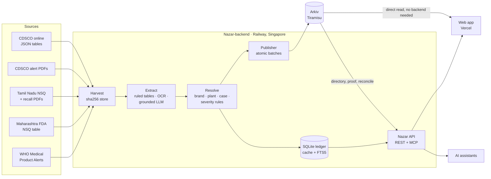

# How Nazar works

Nazar turns scattered regulator notices into one verifiable feed. A Node service on Railway fetches each regulator's documents, reads the batch rows out of them, resolves each row into an alert with a severity, and publishes the alerts to Arkiv, which is the source of truth. A read API (REST and MCP) serves the web app and AI assistants from a local cache, and the web app can also read Arkiv directly from the browser. This page covers the diagram, the pipeline stages, extraction, resolution and severity, the Arkiv data contract in brief, how it stays up to date, the fallback chain and privacy.

**Contents**

- [The diagram](#the-diagram)
- [Principles](#principles)
- [The pipeline](#the-pipeline)
- [Sources](#sources)
- [Extraction tiers](#extraction-tiers)
- [Resolution and severity](#resolution-and-severity)
- [Publishing to Arkiv](#publishing-to-arkiv)
- [The Arkiv data contract, in brief](#the-arkiv-data-contract-in-brief)
- [How it stays up to date](#how-it-stays-up-to-date)
- [The fallback chain](#the-fallback-chain)
- [Privacy](#privacy)

## The diagram



## Principles

- **Truth on chain, caches off chain.** The ledger and search index can be rebuilt from Arkiv.
- **Content-addressed lineage.** Source bytes SHA-256 → row id → alert entity → case. Any alert traces back to the exact document.
- **Deterministic first, AI at the edges.** A table-geometry parser handles almost every row. An LLM sees only rejected rows, and every value it returns must appear in the source text.
- **Never "safe".** Four result states, everywhere: app, API, MCP and feeds.
- **Privacy by locality.** Checks, the cabinet, sweeps and photos stay on your device.

## The pipeline

[`Nazar-backend/`](../Nazar-backend/README.md) is a TypeScript service on Node 24 with a CLI, a cron worker and a Hono API. Each stage reads and writes a typed contract (`src/domain/types.ts`), so any stage can be re-run, tested or replaced on its own.

```
discover → harvest → extract → resolve → publish → Arkiv
```

| Stage | What happens |
|---|---|
| **Discover** | One adapter per regulator finds new documents. |
| **Harvest** | Polite fetching: one request per host every 10 s by default, `robots.txt`, timeouts, bounded retries with jitter, size caps. Bytes are stored by SHA-256 (`data/raw/sha256/ab/<hash>.pdf`). |
| **Extract** | The PDF text layer plus the table rules drawn in the PDF; templates per regulator; OCR fallback; a grounded LLM fallback only for rejected rows ([tiers](#extraction-tiers)). |
| **Resolve** | Brand vs generic, manufacturer and plant (state from the PIN code), one case per batch across notices, severity from a versioned rule table. |
| **Publish** | One atomic `executeBatch` per notice with predicted keys, idempotent by row id, reconciled with Arkiv before sending ([publishing](#publishing-to-arkiv)). |

Every request, document and source has a hard deadline, so one slow government site can't stall a run.

## Sources

| Id | Regulator | Format | Status |
|---|---|---|---|
| `cdsco-online` | CDSCO (`cdscoonline.gov.in`) | JSON tables: monthly NSQ and spurious lists, 2019 onwards | on |
| `cdsco-pdf` | CDSCO (`cdsco.gov.in`) | Alert PDFs, 2024+ landscape and legacy portrait templates | on |
| `tn-dc` | Tamil Nadu Drugs Control | NSQ list PDFs (columns change month to month) and recall notices | on |
| `mh-fda` | Maharashtra FDA | HTML table, mixed date formats, flaky DNS (fallback IP) | on |
| `who-mpa` | WHO Medical Product Alerts | API + PDF annex, India-related alerts only | on |
| `curated` | Nazar curators | Reviewed rows with source links, e.g. the Oct 2025 DEG syrups | on |
| `tg-dca`, `ka-dc`, `kl-dc` | Telangana, Karnataka, Kerala | | off: geo-blocked outside India, or site down |

**What the live server holds (18 Oct 2026):** 23 documents from 6 sources, 1,438 rows, **1,404 alerts published to Arkiv** (21 notices), 32 drug-level records, 9 rows in the curator queue, 0 failed documents. Live numbers: [`/health`](https://nazar-api-production.up.railway.app/health).

## Extraction tiers

1. **Text layer first.** `pdfjs-dist` gives text positions and the table borders drawn in the PDF: columns from the vertical rules, rows from the horizontal ones. Borderless pages fall back to header labels plus `S.No` anchors.
2. **Templates:** `cdsco-modern` (NSQ, State, Spurious), `cdsco-legacy` (one cell holding "B. No. / Mfg dt / Exp dt / Mfd by"), `tn-nsq` (columns mapped from each month's header), `tn-recall`, `who-annex` (products as columns) and `generic`.
3. **Grammar.** Batch labels, YYYYMM dates, firm names after "M/s", 6-digit PIN codes.
4. **Confidence scoring** with the issues listed. A row with an implausible batch is rejected, never guessed.
5. **OCR fallback.** Pages without text are rendered with `@napi-rs/canvas` and read with `tesseract.js`; rejected batch cells are re-read with a batch-only character set.
6. **Grounded LLM fallback.** Only for rejected rows, and only when `ANTHROPIC_API_KEY` is set. The model returns strict JSON; **every value must appear in the row's own source text, or it is dropped**. These rows are marked `llm` and capped at confidence 0.85.

Golden tests check every real fixture: row counts, rejected rows and field-by-field values.

| Confidence | Tier | Result |
|---|---|---|
| ≥ 0.90 | `auto` | published |
| 0.60–0.89 | `machine_read` | published as "Machine-read, awaiting pharmacist confirmation" |
| below 0.60 | `curator_only` | curator queue only |

Rows with no printed batch become drug-level records that can never match a batch check.

## Resolution and severity

- Splits the brand from the generic name.
- Normalises the manufacturer. The plant id is the company slug plus PIN code; the state comes from the PIN prefix.
- Spurious batches record the named maker as `label_claim`, because that maker is the one being impersonated.
- Joins the same batch across notices into one **case** (the Batch Passport).

### Severity

Severity is data, not judgement: a versioned rule table (`sev-2026.10.1`, in `src/domain/severity.ts`), capped at 5. The fired rules are kept on the alert, so the app can explain "why severity 5".

| Base 5 | Base 4 | Base 3 | Base 2 | Base 1 |
|---|---|---|---|---|
| spurious, toxic glycol (DEG/EG) | active ingredient not identified, not sterile, bacterial endotoxins, particulate matter | wrong strength (assay), excess impurities, microbial contamination | dissolution, disintegration, labelling, other | description, pH, content or weight uniformity |

| Modifier | |
|---|---|
| Paediatric formulation | +1 |
| Injectable (injection or infusion) | +1 |
| Narrow-therapeutic-index drug with wrong strength | +1 |

Example: "Adulterated with a toxic glycol: base 5 · Paediatric formulation: +1 (capped at 5)".

## Publishing to Arkiv

- **One atomic `executeBatch` per notice.** The notice and up to 11 alerts land in the first transaction (at most 12 creates each). The notice key is predicted with `predictEntityKeys`, so every alert's `notice` attribute points at it in the same transaction.
- **Idempotent.** Each row has an id, `rid = hash(source sha, row, parser)`. Before sending, the publisher reads Arkiv for rids that already exist, and after a timeout it reconciles by rid. It never resends blindly.
- **One writer per wallet**, serialised, because key prediction depends on the account's nonce.
- **Dry-run by default.** It builds and validates every entity, then runs `eth_estimateGas` on the real calldata. `pnpm cli arkiv:validate` checks the whole ledger against the SDK's limits first.
- **Live mode** (`NAZAR_PUBLISH_MODE=live`) checks the balance first and points to the faucet when it is short.
- **Heartbeat.** A 20-minute entity renewed every 5 minutes by the worker. If the pipeline dies, the heartbeat expires and the app's status pill changes from "Pipeline live" to "pipeline paused" or "Pipeline idle".
- **Measured cost:** about 210k gas per alert (a 12-alert batch is about 2.5M gas and 71 KB of calldata).

## The Arkiv data contract, in brief

| | |
|---|---|
| Network | Arkiv Tiramisu testnet, chain `7738577` |
| Publisher | [`0xd06d85Eb20f126f796E4a341b711B1a757c66bD2`](https://tiramisu.explorer.arkiv.network/address/0xd06d85Eb20f126f796E4a341b711B1a757c66bD2), the only trusted `$creator` |
| Project tag | `project = "nazar-in-batch-alerts"` on every entity, with `t` (type) and `v` (schema version) |
| Types | `notice` (5 years), `alert` (batch expiry + 180 days), `retraction` (alert's life + 1 year), `heartbeat` (20 minutes), `snapshot` (7 days; defined, none live) |
| Flags | everything `readonly`; alerts also `permissionlessExtension` |
| Rule | queried fields are typed attributes (months as `YYYYMM` integers); display detail is the JSON payload |

The full contract (every attribute, lifetimes, write rules, the queries Q1–Q7, cost) is [`arkiv/schema.md`](../arkiv/schema.md). How to read it yourself: [docs/arkiv.md](arkiv.md).

## How it stays up to date

No one is in the loop. A new notice is fetched, read, resolved and published to Arkiv on a schedule.

| Where | What | When |
|---|---|---|
| Railway worker | CDSCO sources | every 6 hours (`NAZAR_CRON_CDSCO`, default `0 */6 * * *`) |
| Railway worker | State regulators and WHO | every 3 hours (`NAZAR_CRON_STATES`, default `30 */3 * * *`) |
| Railway worker | Renew the heartbeat entity on Arkiv | every 5 minutes (`NAZAR_CRON_HEARTBEAT`) |
| GitHub Actions: **CI** (`ci.yml`) | Backend typecheck and tests with coverage; frontend typecheck, scanner tests and build; then the e2e suite in headless Chrome | every push |
| GitHub Actions: **Pipeline** (`pipeline.yml`) | Harvest, extract and publish (dry-run unless `NAZAR_PUBLISH_MODE=live` and the key are in the repo secrets) | every 6 hours |
| GitHub Actions: **Monitor** (`monitor.yml`) | Fails (and emails the owner) if the API is down, CDSCO is unreachable from the server's region, the heartbeat is stale, or SR-13 stops being flagged | hourly |
| GitHub Actions: **Refresh saved snapshot** (`snapshot.yml`) | Fetches the API snapshot into `Nazar-frontend/public/data/snapshot.json` and commits it only if it changed, which redeploys the site | daily (07:10 IST) |

Each run reconciles with Arkiv before sending, so nothing is published twice. The backend runs on Railway in **Singapore** because CDSCO refuses connections from US cloud regions; `/health` reports the region and CDSCO reachability on every boot.

## The fallback chain

Every check in the web app tries these in order, and the answer says which one it came from:

1. **Nazar API**, through the same-origin `/api/nazar/*` rewrite, cached at Vercel's edge.
2. **Arkiv, from the browser**, filtered by the project tag and the publisher's `$creator`. No Nazar server needed.
3. **Nazar's saved copy:** the snapshot kept on the device (IndexedDB), else the site's own `/data/snapshot.json`.
4. **Demo data**, only offline on a first visit with none of the above.

When the saved copy is loaded, it answers instantly (before any network call) and the live source then confirms or corrects the card. A saved copy leads only while it is under 7 days old, and a saved "no alert" only while it is under a day old. Offline, the saved copy is the final answer. A garbled batch is answered "Can't tell" on the device and never leaves it.

The API itself has a fallback too: `/v1/check` answers from the ledger, and reads Arkiv when the ledger has nothing for a batch, so a fresh deploy with an empty ledger still answers from the chain.

## Privacy

- **Checks:** a single batch number goes to the API (or Arkiv); recent checks are kept only on the device.
- **Cabinet and "new since your last visit":** `localStorage` only; a re-check sends each batch on its own, never names, notes or the list.
- **Shelf sweep:** the list, file, product names and quantities never leave the browser; only flagged and look-alike batch numbers are confirmed with the API, one request each.
- **Photos:** decoded and read on the device. Only the opt-in AI guess sends the label **text**, never the image.
- **AI endpoints:** the batch number is never sent to the model; clients are rate-limited by a salted IP hash held only in memory.
- **MCP:** receives only tool arguments; logs keep the tool name, outcome and duration, never the arguments.
- **Off Arkiv by design:** source PDFs (their SHA-256 is stored instead), anything about users, and the search index.
